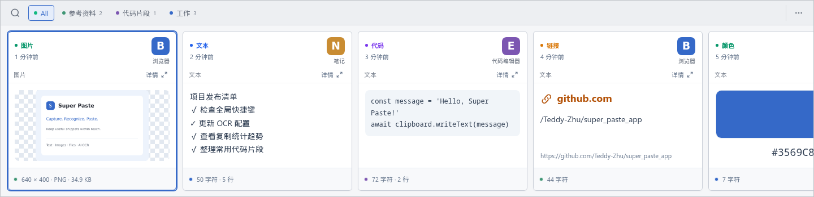
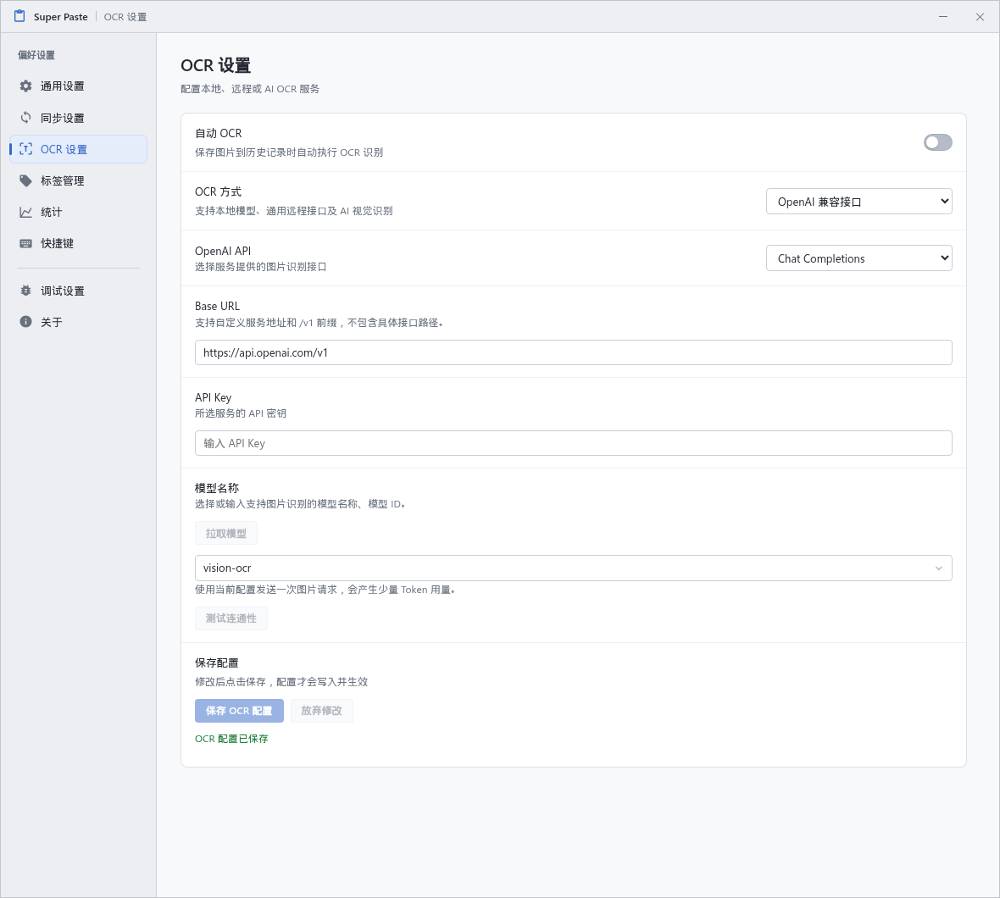
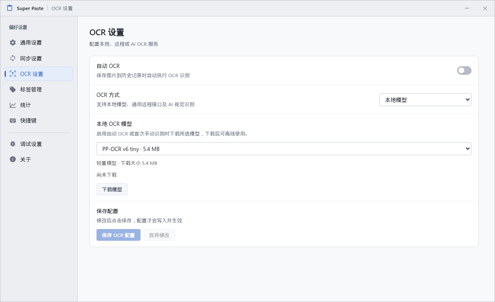
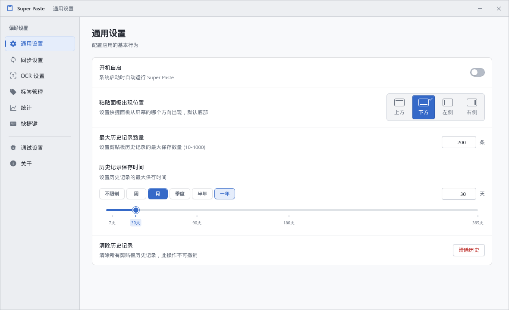
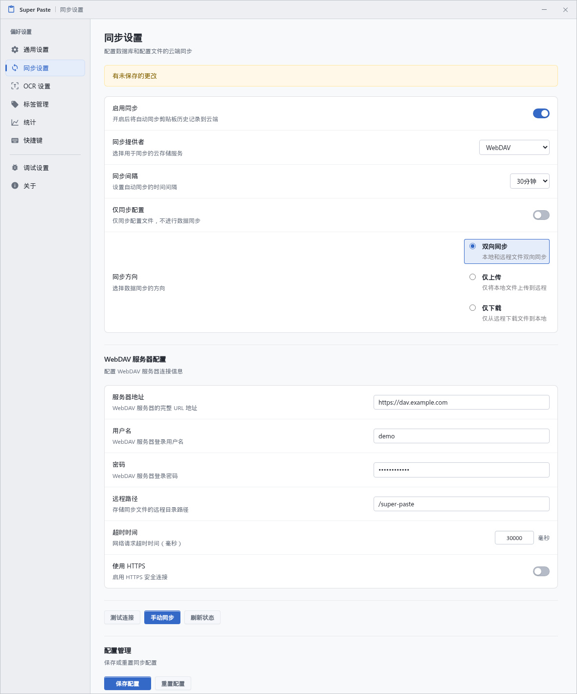

# Super Paste

一款基于 Tauri 2、Rust、Vue 3 和 TypeScript 的桌面剪贴板管理工具。保存复制历史，通过快捷面板搜索、分类和恢复内容，支持本地／远程／AI 图片 OCR、复制与 Token 用量统计、WebDAV 同步，以及供 AI 工具调用的本地 MCP 服务。

[发布版本](https://github.com/Teddy-Zhu/super_paste_app/releases) · [界面预览](#界面预览) · [MCP 接入](#mcp-服务) · [问题反馈](https://github.com/Teddy-Zhu/super_paste_app/issues) · [参与贡献](#参与贡献)

## 功能

- **剪贴板历史**：记录文本、图片、文件等内容，支持详情预览；可设置记录数量与保存期限。
- **快捷面板**：通过自定义全局快捷键呼出，支持搜索、键盘导航和数字快捷选择；可从屏幕上、下、左、右四个方向出现。
- **分类管理**：创建带颜色和描述的标签，按标签或来源应用筛选记录。
- **图片 OCR**：支持本地离线模型、自定义远程 HTTP 接口、OpenAI 与 Claude 兼容接口，可自动或手动识别图片。
- **AI OCR 配置**：自定义 Base URL、API Key 和模型，支持拉取模型列表与连通性测试；OpenAI 可选择 Chat Completions 或 Responses 接口。
- **本地模型管理**：按需下载、取消下载、删除模型或强制重新下载。
- **统计**：按时间、内容类型、来源应用查看复制次数、数据量和趋势；按模型查看 AI 请求与 Token 用量，两类统计可分别清空。
- **WebDAV 配置同步**：支持手动与定时同步、上传／下载／双向同步；仅同步非敏感设置，并发冲突保留双方版本并报告。
- **MCP 服务**：通过本地 Streamable HTTP 接口向 AI 工具开放剪贴板读写、历史搜索和 OCR；支持可选 API Key 验证，以及基于 SSE 的剪贴板变化实时推送。
- **桌面集成**：系统托盘、开机启动和可调整大小的设置窗口；粘贴面板自动适配屏幕可用空间。

## 界面预览

### 粘贴面板

搜索、类型与标签筛选，多种内容卡片及来源应用展示。



### AI OCR 设置

选择 OpenAI 或 Claude 兼容接口，配置服务地址、密钥、模型与接口类型。



### 本地 OCR 模型

选择离线模型并管理下载、删除与重新下载。



### 复制统计

按时间、类型和来源应用筛选，查看汇总、折线趋势及分类明细。


### AI Token 用量

查看输入、输出、缓存 Token、请求耗时、模型用量和请求记录。


### 通用设置

设置历史保存策略和粘贴面板位置。



### WebDAV 同步设置

配置服务器、同步方向与间隔，测试连接或手动同步。



## 安装与使用

从 [Releases](https://github.com/Teddy-Zhu/super_paste_app/releases) 下载适用于当前系统的安装包。

| 系统                        | 安装包格式                                                        |
| --------------------------- | ----------------------------------------------------------------- |
| Windows x64                 | NSIS（`.exe`）、MSI（`.msi`）、便携版（`.zip`）                   |
| macOS Intel / Apple Silicon | DMG（`.dmg`）                                                     |
| Linux x64                   | DEB、RPM、AppImage、Pacman（`.pkg.tar.zst`）、便携版（`.tar.gz`） |

1. 启动应用，进入设置窗口的「快捷键」页面，设置用于呼出粘贴面板的组合键。初始未配置全局快捷键。
2. 复制内容，应用会将其保存到本地历史记录。
3. 使用已配置的快捷键打开面板，搜索或切换分类，恢复需要的内容。
4. 按需配置保存期限、面板出现位置、标签、OCR、同步或 MCP 服务；在「统计」页面查看复制活动和 AI 用量。

面板中的常用键盘操作：

| 操作                        | 按键                               |
| --------------------------- | ---------------------------------- |
| 移动选择                    | 方向键                             |
| 选择首条／末条记录          | `Ctrl/⌘ + Home` / `Ctrl/⌘ + End`   |
| 恢复选中的内容              | `Enter`                            |
| 快速恢复当前列表前 9 条记录 | `Ctrl + 1…9`；macOS 使用 `⌘ + 1…9` |
| 退出当前搜索或关闭面板      | `Esc`                              |

### OCR

在「OCR 设置」中选择识别方式，修改后点击「保存 OCR 配置」。

| 识别方式        | 配置与使用                                                                   |
| --------------- | ---------------------------------------------------------------------------- |
| 本地模型        | 首次使用需下载所选模型，完成后可离线识别；支持删除与强制重新下载。           |
| 远程 HTTP       | 配置接口地址、JSON 或 multipart 表单格式、图片字段、额外参数与返回结果路径。 |
| OpenAI 兼容接口 | 配置 Base URL、API Key 与视觉模型，可选 Chat Completions 或 Responses。      |
| Claude 兼容接口 | 配置 Base URL、API Key 与视觉模型，使用 Claude Messages 协议。               |

AI 模式下，可点击「拉取模型」后从列表中选择模型，或手动填写模型 ID。模型须支持图片输入。「测试连通性」会发送一次图片请求，并计入 AI 用量。

启用自动 OCR 后，保存到历史记录的图片会自动识别。图片右键菜单支持手动识别和重新识别。删除当前启用的本地模型时，会关闭自动 OCR。

### 复制与 AI 用量统计

进入「统计」，切换「复制统计」和「Token 用量」：

- **复制统计**：查看复制次数、剪贴板数据量、文件数量和活跃天数；支持时间范围、内容类型和来源应用筛选，以及按小时／天／月查看趋势。数据量包含文本、图片和文件路径，不包含所复制文件的本体大小。
- **Token 用量**：查看请求次数、失败次数、输入／输出／缓存 Token、累计耗时、模型用量和趋势。统计以接口实际返回的用量为准，包含连通性测试；接口未返回用量时会单独计数。缓存 Token 已包含在输入用量中。

统计从功能启用后开始累计，独立于历史记录保存。两类统计可分别清空，清空操作会删除对应类型的全部统计数据。

AI 用量按小时汇总，并保留最近 50 条请求明细。

### WebDAV 同步

在「同步设置」中填写服务器地址、用户名、密码与远程目录，测试连接并保存配置。支持手动同步、定时同步，以及上传／下载／双向同步；下载后按页面提示重启。

同步文档保存在所配置远程目录下的 `super_paste/v1/config.json`。同步范围仅包含可跨设备复用的非敏感设置，不同步历史、图片、标签、统计或数据库。

API Key、WebDAV 口令、MCP 密钥、远程 OCR 地址与自由额外参数，以及本机路径、权限状态和 MCP 连接信息不会同步。新设备需重新填写本机凭据与连接设置。双向同步时，若本机与远端都发生修改，会保留双方并报告冲突；手动上传或下载可明确选择覆盖方向。

### MCP 服务

在设置窗口进入「MCP 服务」，将 Super Paste 的能力连接到同一台电脑上的 AI 工具。服务默认关闭，仅监听 `127.0.0.1`，默认地址为 `http://127.0.0.1:19528/mcp`，使用 MCP Streamable HTTP 协议。

1. 开启「开启 MCP」，按需修改端口（1024–65535）。
2. API Key 验证默认开启，点击「生成密钥」或填写自己的密钥；请求需携带 `Authorization: Bearer <API_KEY>`。
3. 点击「保存并应用」，确认状态为「运行中」。应用运行期间提供服务，下次启动会恢复已保存的开关状态。
4. 在页面下方选择 AI 工具，复制配置并合并到对应配置文件，然后重新连接。页面示例使用已保存的端口和密钥。

AI 工具须能访问运行 Super Paste 的本机地址；云端连接器无法直接访问此地址。连接后可读取剪贴板和历史记录、写入文本；关闭 Key 验证后，本机其他程序也可访问。

#### 可用工具

| 工具                            | 能力与主要参数                                                                                                  |
| ------------------------------- | --------------------------------------------------------------------------------------------------------------- |
| `get_clipboard`                 | 读取当前文本、HTML、RTF、文件路径和图片信息；`includeImage: true` 返回 PNG 图片。返回 `cursor` 可用于等待变化。 |
| `set_clipboard_text`            | 将 `text` 写入系统剪贴板，覆盖当前内容，不模拟粘贴。                                                            |
| `search_clipboard_history`      | 用 `searchText` 搜索内容或 OCR 文字；支持 `limit`（默认 20，最大 100）和 `offset` 分页，按复制时间倒序返回。    |
| `get_clipboard_history_item`    | 按 `itemId` 读取历史记录；可设置 `includeImage: true` 获取图片。                                                |
| `ocr_image`                     | 识别 `imageBase64` 或历史 `itemId` 指定的图片；两者都不传时识别当前剪贴板图片。                                 |
| `subscribe_clipboard_changes`   | 为当前 MCP 会话订阅剪贴板变化，通过 SSE 推送内容快照。                                                          |
| `unsubscribe_clipboard_changes` | 取消当前会话的订阅，不影响其他客户端。                                                                          |
| `wait_for_clipboard_change`     | 不使用订阅时，可传入 `cursor` 等待变化；`timeoutMs` 最长 30000 毫秒，超时后可继续调用。                         |

`ocr_image` 的 `imageBase64` 支持原始 Base64 或图片 data URL，不可与 `itemId` 同时传入；图片最大 10 MiB。识别使用当前 OCR 设置：本地模式须先下载模型，远程或 AI 模式会向所配置服务提交图片，并可能产生费用。剪贴板图片读取受同样的 10 MiB 限制。

#### AI 工具配置

以下示例使用默认端口，并启用 Key 验证。将 `YOUR_API_KEY` 替换为已保存的密钥；关闭验证时删除 `headers`，Codex 则删除 `bearer_token_env_var`。修改端口后同步更新 `url`。配置中的密钥应保存在本机私有文件中。

**Cursor**：合并到全局 `~/.cursor/mcp.json` 或项目 `.cursor/mcp.json`，在 MCP 设置中启用服务。[官方文档](https://cursor.com/docs/mcp)

```json
{
  "mcpServers": {
    "super-paste": {
      "url": "http://127.0.0.1:19528/mcp",
      "headers": {
        "Authorization": "Bearer YOUR_API_KEY"
      }
    }
  }
}
```

**Claude Code**：合并到项目 `.mcp.json`，重新打开 Claude Code 并按提示启用项目 MCP 服务；通过 `/mcp` 查看连接状态。[官方文档](https://code.claude.com/docs/en/mcp)

```json
{
  "mcpServers": {
    "super-paste": {
      "type": "http",
      "url": "http://127.0.0.1:19528/mcp",
      "headers": {
        "Authorization": "Bearer YOUR_API_KEY"
      }
    }
  }
}
```

**Codex**：合并到 `~/.codex/config.toml`，在启动 Codex 的环境中设置 `SUPER_PASTE_MCP_KEY` 为密钥，然后重新打开 Codex。[官方文档](https://developers.openai.com/codex/mcp)

```toml
[mcp_servers.super-paste]
url = "http://127.0.0.1:19528/mcp"
bearer_token_env_var = "SUPER_PASTE_MCP_KEY"
tool_timeout_sec = 180
```

例如，在 sh/zsh 中执行 `export SUPER_PASTE_MCP_KEY='YOUR_API_KEY'`，PowerShell 中执行 `$env:SUPER_PASTE_MCP_KEY = 'YOUR_API_KEY'`，再从该环境启动 Codex。

**VS Code / Copilot**：合并到项目 `.vscode/mcp.json`，通过 `MCP: List Servers` 启动服务，并在聊天工具列表中启用。[官方文档](https://code.visualstudio.com/docs/agents/reference/mcp-configuration)

```json
{
  "servers": {
    "super-paste": {
      "type": "http",
      "url": "http://127.0.0.1:19528/mcp",
      "headers": {
        "Authorization": "Bearer YOUR_API_KEY"
      }
    }
  }
}
```

#### 剪贴板实时推送

调用 `subscribe_clipboard_changes`，或通过 `resources/subscribe` 订阅资源 `super-paste://clipboard/current`。客户端使用初始化响应返回的 `Mcp-Session-Id`，在同一 `/mcp` 地址建立 GET 连接，携带 `Accept: text/event-stream`；后续 GET、POST、DELETE 请求均携带会话 ID 和已配置的 Key。标准 MCP 客户端可自动管理会话和 SSE 连接。

每次监听到内容变化，服务通过 SSE 发送 `notifications/resources/updated`，其中 `_meta["super-paste/clipboard"]` 是 Super Paste 附带的变化快照：

```json
{
  "jsonrpc": "2.0",
  "method": "notifications/resources/updated",
  "params": {
    "uri": "super-paste://clipboard/current",
    "_meta": {
      "super-paste/clipboard": {
        "cursor": "<cursor>",
        "timestamp": 1760000000000,
        "content": { "text": "示例内容" }
      }
    }
  }
}
```

快照可包含文本、HTML、RTF、文件路径和图片字节数；图片本体需另行通过工具读取。也可通过 `resources/read` 读取当前资源。推送依赖系统剪贴板监听权限，与历史自动保存开关无关。

调用 `unsubscribe_clipboard_changes`、`resources/unsubscribe` 或 `DELETE /mcp` 可结束订阅。SSE 断线期间的变化不重放，重连后应重新读取当前内容；无活动连接或请求的会话在 5 分钟后清理，失效后须重新初始化。

AI 工具对资源通知的处理方式不同，接收推送不代表会自动触发模型回复。不支持订阅时可使用 `wait_for_clipboard_change`，变化后调用 `get_clipboard` 读取当前内容。

#### 连接排查

- 无法连接：确认应用仍在运行，MCP 状态为「运行中」，客户端地址与已保存端口一致；端口被占用时更换端口。
- 返回 HTTP 401：检查 `Authorization: Bearer <API_KEY>` 与页面保存的密钥是否一致。
- 提示缺少会话 ID 或会话失效：让客户端重新初始化 MCP 会话，后续请求携带返回的 `Mcp-Session-Id`。
- 无法订阅或等待变化：检查系统剪贴板权限，并在「调试设置」中确认已开启监听。
- 本地 OCR 提示模型未下载：进入「OCR 设置」下载当前所选模型。

## 平台说明

提供 Windows x64、macOS Intel x64 / Apple Silicon 和 Linux x64 安装包。系统依赖与桌面环境要求如下：

| 平台或环境           | 说明                                                                       |
| -------------------- | -------------------------------------------------------------------------- |
| Windows              | 使用系统 WebView2；便携版也需要安装 WebView2 Runtime。                     |
| macOS                | 最低版本为 13.3；按系统提示授权来源识别与桌面交互能力。                    |
| Linux X11            | 支持原生活动窗口识别、全局快捷键与粘贴面板。                               |
| KDE Plasma 6 Wayland | 全局快捷键需要桌面门户授权。                                               |
| 其他 Wayland 桌面    | 支持范围因桌面环境而异；GNOME 活动窗口识别需要安装 x-win 上游 Shell 扩展。 |

Wayland 全局快捷键可能需要桌面门户授权，可在设置中查看状态并重试；也可在系统快捷键中绑定 `super_paste --toggle-overlay`。

凭据使用 Windows Credential Manager、macOS Keychain 或 Linux Secret Service。Linux 需要可用的 Secret Service 提供者；不可用时凭据操作会报告错误，本地历史仍可使用。Linux 便携包内含 AppImage，需要 FUSE 2 或兼容的 AppImage 运行环境。

Windows 安装包尚未签名；macOS 安装包尚未签名和公证。

## 开发与构建

### 环境要求

- Node.js **24**、pnpm **11.4.0**，与 `package.json` 保持一致。
- Rust stable 工具链。
- Linux：WebKitGTK 4.1、GTK 3、Ayatana AppIndicator、GTK Layer Shell、Wayland、OpenSSL、librsvg 和 X11 的开发依赖。
- Windows：MSVC C++ 构建工具与 WebView2 Runtime。
- macOS：Xcode 命令行工具。

在仓库根目录执行：

```sh
git clone https://github.com/Teddy-Zhu/super_paste_app.git
cd super_paste_app
corepack enable pnpm
pnpm install
pnpm dev
```

首次运行 `pnpm dev` 或 `pnpm build` 时会自动准备 OCR 运行库。macOS Intel 的运行库需要从源码编译，首次准备耗时较长。开发模式支持前端热更新。

### 常用命令

| 命令                       | 用途                                   |
| -------------------------- | -------------------------------------- |
| `pnpm dev`                 | 启动 Tauri 开发模式                    |
| `pnpm dev:renderer`        | 仅启动 Vite 前端，不能独立使用桌面功能 |
| `pnpm build:renderer`      | 前端类型检查与生产构建                 |
| `pnpm lint`                | 运行 ESLint                            |
| `pnpm format`              | 格式化文件，会写入文件                 |
| `pnpm build`               | 构建当前平台安装包                     |
| `pnpm build --bundles deb` | 仅构建 Debian 安装包                   |
| `pnpm build:pacman`        | 构建 Arch Linux 安装包                 |

### 本地打包

在对应目标系统运行：

```sh
pnpm build
```

安装包输出到 `target/release/bundle/`。

在 x86_64 Arch Linux 上安装 `base-devel` 与 `libarchive` 后，可以直接生成本地 Pacman 包：

```sh
pnpm build:pacman
```

Pacman 包输出到 `target/packages/super-paste_<version>_x86_64.pkg.tar.zst`，包名为 `super-paste-bin`。

## 数据与隐私

应用标识为 `com.v2dawn.superpaste`，各平台的默认数据目录如下：

| 平台    | 默认目录                                                                                  |
| ------- | ----------------------------------------------------------------------------------------- |
| Windows | `%LOCALAPPDATA%/com.v2dawn.superpaste`                                                    |
| macOS   | `~/Library/Application Support/com.v2dawn.superpaste`                                     |
| Linux   | `$XDG_DATA_HOME/com.v2dawn.superpaste`，未设置时为 `~/.local/share/com.v2dawn.superpaste` |

`app.db` 保存历史、标签、来源、设置与统计，已下载模型保存在 `ocr-models/`；缓存和日志使用对应的系统目录。API Key、WebDAV 口令与 MCP 密钥存系统凭据库，不进入普通配置、WebDAV 文档或诊断包。历史数据库未启用数据库加密。

本地 OCR 的模型下载需要联网，识别在本机执行。远程 HTTP、OpenAI 与 Claude OCR 会向所配置接口提交图片，连通性测试也会发送测试图片。MCP 开启后，连接到服务的本机客户端可读取剪贴板与历史。

## 项目结构

```text
src/renderer/src/        # Vue 页面、组件与状态管理
src/shared/              # 前后端契约、类型与常量
src-tauri/src/           # Rust 桌面服务、窗口、剪贴板、OCR、同步与 MCP
src-tauri/vendor/        # 平台依赖与补丁
crates/data-format/      # 共享数据格式
resources/              # OCR 模型清单与运行库资源
scripts/                # 开发、构建、打包与发布入口
packaging/              # AUR 模板与便携包说明
docs/                   # 项目文档与截图
```

## 参与贡献

欢迎通过 [Issues](https://github.com/Teddy-Zhu/super_paste_app/issues) 报告问题或提出建议，通过 Pull Request 提交改进。

- 报告问题时，请提供应用版本、操作系统、桌面环境、复现步骤和预期行为；UI 问题可附截图。
- 提交前运行与改动相关的 lint、类型检查或构建，并格式化修改过的文件。
- PR 中说明改动目的、验证结果及已知限制；涉及界面或平台能力时，附上实际运行环境和验证说明。
- 请勿提交构建产物、下载的 OCR 模型、个人剪贴板数据或同步凭据。

## 许可证

本项目采用 [MIT License](LICENSE)。第三方代码、底层封装和 OCR 依赖的来源与许可见 [THIRD-PARTY-NOTICES.md](THIRD-PARTY-NOTICES.md)，随包运行库也包含对应声明。
