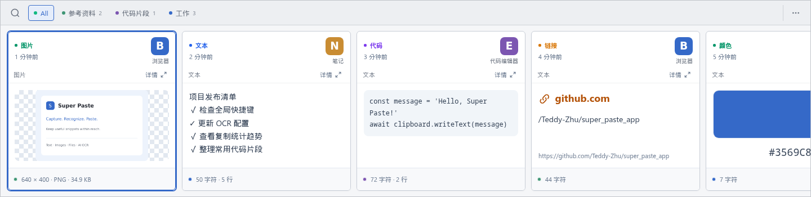
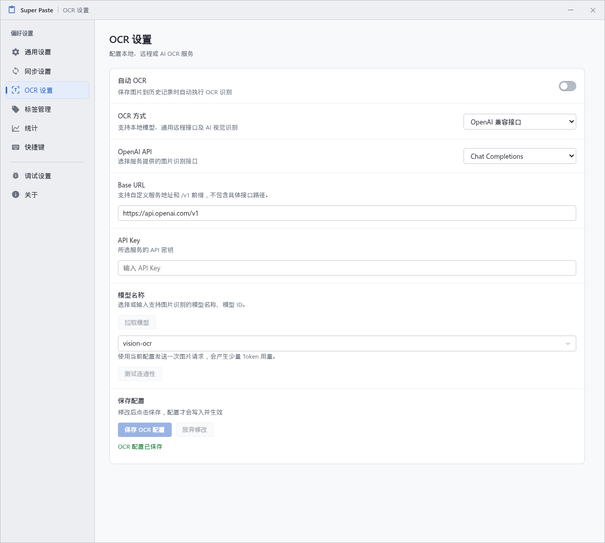
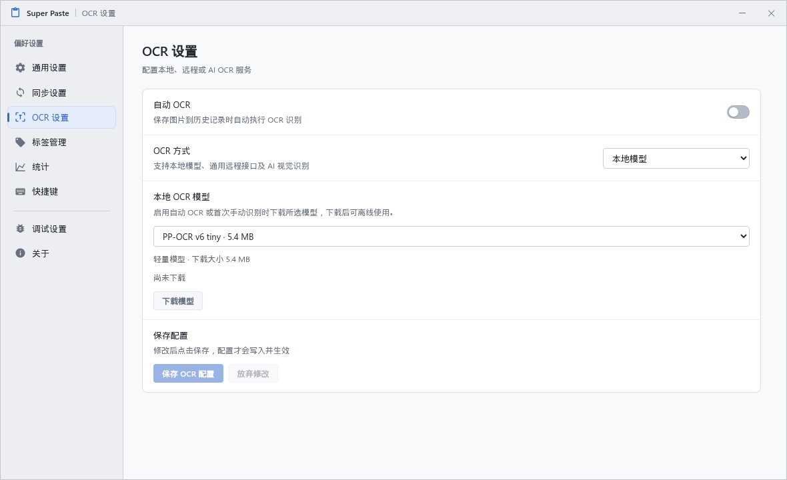
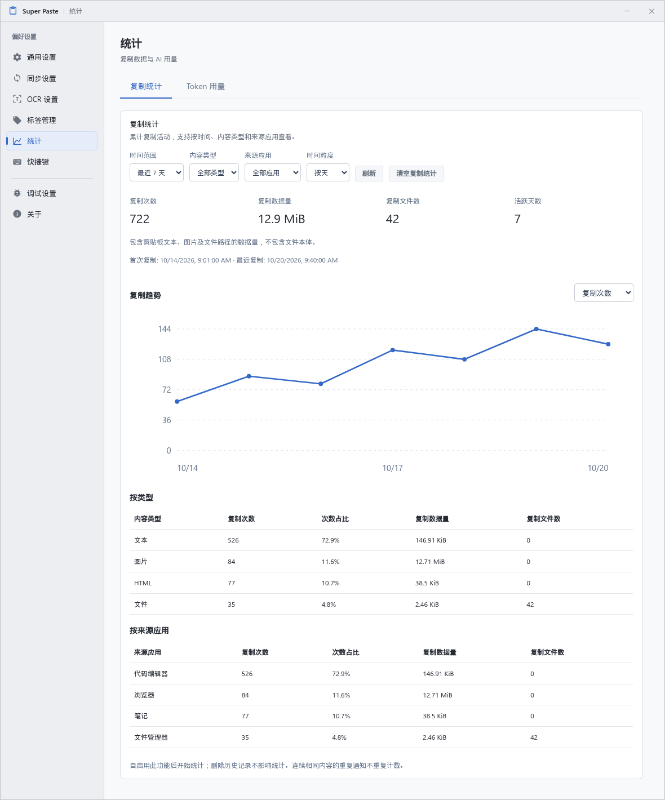
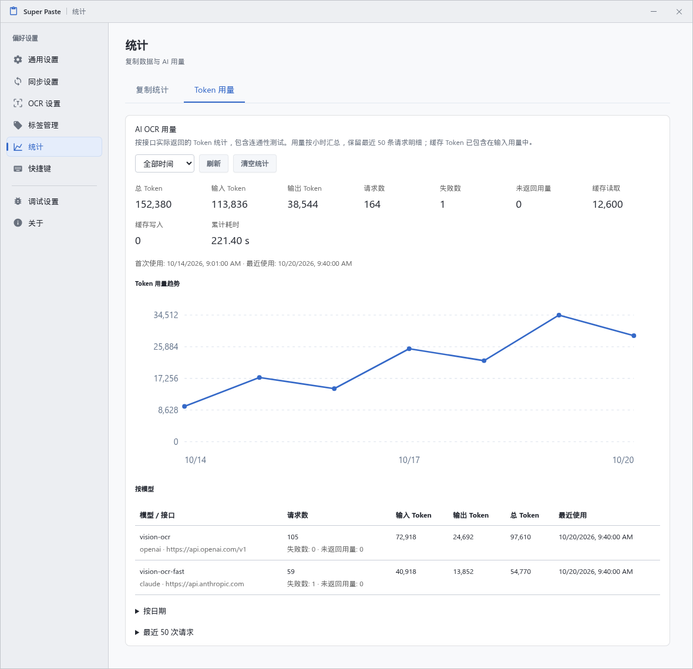
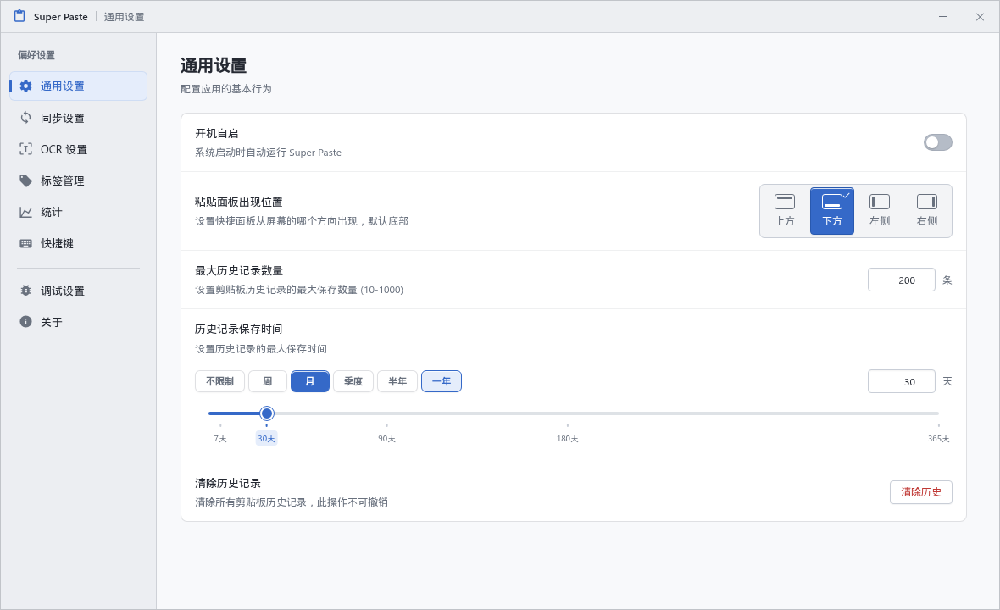
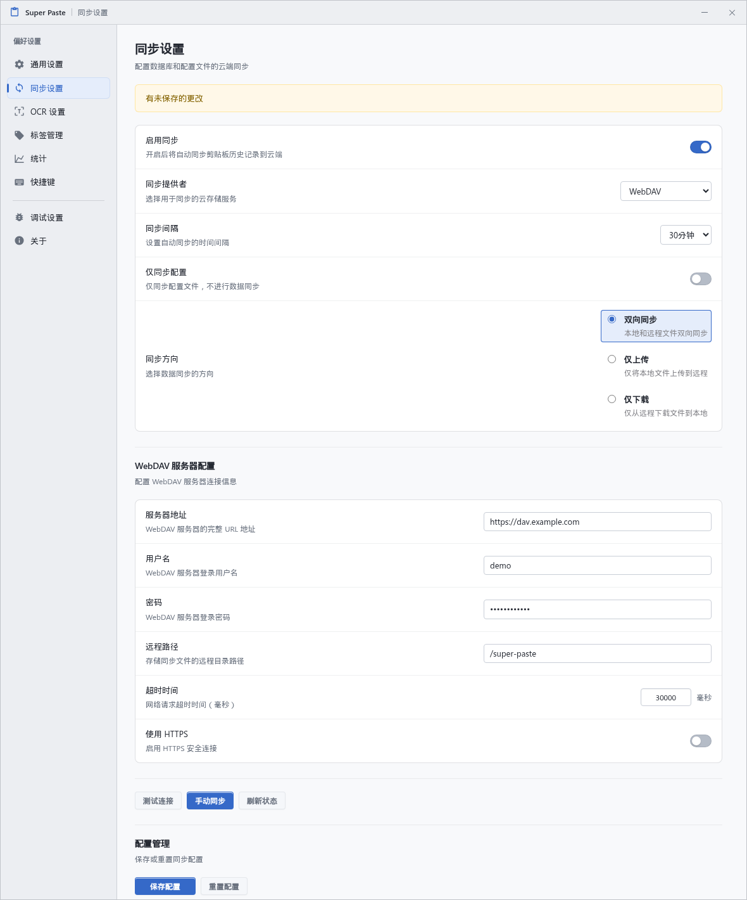

# Super Paste

一款基于 Electron、Vue 3 和 TypeScript 的桌面剪贴板管理工具。保存复制历史，通过快捷面板搜索、分类和恢复内容，支持本地／远程／AI 图片 OCR、复制与 Token 用量统计，以及可选的 WebDAV 同步。

[发布版本](https://github.com/Teddy-Zhu/super_paste_app/releases) · [界面预览](#界面预览) · [问题反馈](https://github.com/Teddy-Zhu/super_paste_app/issues) · [参与贡献](#参与贡献)

## 功能

- **剪贴板历史**：记录文本、图片、文件等内容，支持详情预览；可设置记录数量与保存期限。
- **快捷面板**：通过自定义全局快捷键呼出，支持搜索、键盘导航和数字快捷选择；可从屏幕上、下、左、右四个方向出现。
- **分类管理**：创建带颜色和描述的标签，按标签或来源应用筛选记录。来源识别能力取决于操作系统与桌面环境。
- **图片 OCR**：支持本地离线模型、自定义远程 HTTP 接口、OpenAI 与 Claude 兼容接口；后台异步识别，图片右键菜单支持重新识别。
- **AI OCR 配置**：自定义 Base URL、API Key 和模型，支持拉取模型列表与连通性测试；OpenAI 可选择 Chat Completions 或 Responses 接口。
- **本地模型管理**：按需下载、取消下载、删除模型或强制重新下载。
- **统计**：按时间、内容类型、来源应用查看复制次数、数据量和趋势；按模型查看 AI 请求与 Token 用量，两类统计可分别清空。
- **WebDAV 同步**：支持手动与定时同步、上传／下载／双向同步，以及仅同步配置。
- **桌面设置窗口**：支持调整窗口宽高，最小尺寸为 720 × 520，内容随可用空间换行和滚动。

## 界面预览

以下截图来自应用实际界面，使用独立的演示数据；模型名称、统计数值与文件路径仅用于展示。

### 粘贴面板

搜索、类型与标签筛选，多种内容卡片及来源应用展示。



### AI OCR 设置

选择 OpenAI 或 Claude 兼容接口，配置服务地址、密钥、模型与接口类型。



### 本地 OCR 模型

选择离线模型并管理下载、删除与重新下载。



### 复制统计

按时间、类型和来源应用筛选，查看汇总、折线趋势及分类明细。



### AI Token 用量

查看输入、输出、缓存 Token、请求耗时、模型用量和请求记录。



### 通用设置

设置历史保存策略和粘贴面板位置。



### WebDAV 同步设置

配置服务器、同步方向与间隔，测试连接或手动同步。



## 安装与使用

可在 [Releases](https://github.com/Teddy-Zhu/super_paste_app/releases) 查看发布版本。如没有适合当前系统的安装包，可按下文从源码运行或打包。

1. 启动应用，进入设置窗口的「快捷键」页面，设置用于呼出粘贴面板的组合键。初始未配置全局快捷键。
2. 复制内容，应用会将其保存到本地历史记录。
3. 使用已配置的快捷键打开面板，搜索或切换分类，恢复需要的内容。
4. 按需配置保存期限、面板出现位置、标签、OCR 或同步服务；在「统计」页面查看复制活动和 AI 用量。

面板中的常用键盘操作：

| 操作                        | 按键                               |
| --------------------------- | ---------------------------------- |
| 移动选择                    | 方向键                             |
| 选择首条／末条记录          | `Ctrl/⌘ + Home` / `Ctrl/⌘ + End`   |
| 恢复选中的内容              | `Enter`                            |
| 快速恢复当前列表前 9 条记录 | `Ctrl + 1…9`；macOS 使用 `⌘ + 1…9` |
| 退出当前搜索或关闭面板      | `Esc`                              |

### OCR

在「OCR 设置」中选择识别方式，修改后点击「保存 OCR 配置」。

| 识别方式        | 配置与使用                                                                   |
| --------------- | ---------------------------------------------------------------------------- |
| 本地模型        | 首次使用需下载所选模型，完成后可离线识别；支持删除与强制重新下载。           |
| 远程 HTTP       | 配置接口地址、JSON 或 multipart 表单格式、图片字段、额外参数与返回结果路径。 |
| OpenAI 兼容接口 | 配置 Base URL、API Key 与视觉模型，可选 Chat Completions 或 Responses。      |
| Claude 兼容接口 | 配置 Base URL、API Key 与视觉模型，使用 Claude Messages 协议。               |

AI 模式下，点击「拉取模型」可展开接口返回的完整模型列表，也可在同一个输入框中手动填写模型 ID；输入内容不会筛选列表。选择的模型须支持图片输入。「测试连通性」会发送一次图片请求，并计入 AI 用量。

启用自动 OCR 后，保存图片到历史记录时会自动识别。所有识别方式都在后台异步执行，同一图片不会同时发起多个 OCR 请求；图片右键菜单可以手动识别或重新识别。删除当前启用的本地模型时，会关闭自动 OCR。

### 复制与 AI 用量统计

进入「统计」，切换「复制统计」和「Token 用量」：

- **复制统计**：查看复制次数、剪贴板数据量、文件数量和活跃天数；支持时间范围、内容类型和来源应用筛选，以及按小时／天／月查看趋势。数据量包含文本、图片和文件路径，不包含所复制文件的本体大小。
- **Token 用量**：查看请求次数、失败次数、输入／输出／缓存 Token、累计耗时、模型用量和趋势。统计以接口实际返回的用量为准，包含连通性测试；接口未返回用量时会单独计数。缓存 Token 已包含在输入用量中。

统计从功能启用后开始累计，不从历史记录反推；删除或清理历史不会减少已有统计。两类统计可分别清空，清空作用于该类全部统计，不仅是当前筛选范围。

统计在内存中合并后延迟批量落库；AI 用量按小时汇总，保留最近 50 条请求明细，减少逐条记录带来的存储开销。

### WebDAV 同步

在「同步设置」中填写服务器地址、用户名、密码与远程目录，可先测试连接，再保存配置。支持手动同步、定时同步和仅同步配置；下载数据后按应用提示重启以生效。

同步以数据库和配置文件为单位。双向同步根据文件修改时间选择上传或下载，不会逐条合并两台设备的历史记录；多设备同时修改时，请留意文件覆盖。

## 平台说明

项目提供 Windows、macOS 和 Linux 的打包配置。平台相关能力受系统权限、桌面环境和原生依赖支持范围影响。

| 平台或环境      | 说明                                                                                           |
| --------------- | ---------------------------------------------------------------------------------------------- |
| Windows / macOS | 提供对应打包命令；macOS 来源应用识别可能需要屏幕录制权限。                                     |
| Linux X11       | 使用原生活动窗口后端识别来源应用。                                                             |
| Linux Wayland   | 来源应用识别使用 KWin 后端，当前支持 KDE Plasma 6；该后端不支持 GNOME、其他合成器或 Plasma 5。 |

Wayland 下的全局快捷键可能需要桌面门户授权，可在「快捷键」页面查看状态并重试。如果桌面环境无法注册，可在系统快捷键设置中绑定应用可执行文件并附加 `--toggle-overlay` 参数；页面会显示当前可执行文件的完整命令。

KWin 后端的构建要求与支持范围见 [原生模块说明](packages/active-window-kwin/README.md)。

## 从源码运行

### 环境要求

- Node.js **22.14.0 或更高版本**。
- pnpm **11.4.0**，与 `package.json` 的 `packageManager` 保持一致。
- 原生模块需要与当前操作系统和架构匹配；没有可用预编译产物时，需要相应的 C/C++ 编译环境。
- Linux 首次构建缺失的 KWin 原生模块时，还需要 **Rust / Cargo 1.88+** 与 C 编译工具链，并能访问 crates.io 和 GitHub。

在仓库根目录执行：

```sh
git clone https://github.com/Teddy-Zhu/super_paste_app.git
cd super_paste_app
pnpm install
pnpm dev
```

安装依赖会执行 Electron 原生依赖准备。开发模式支持热更新，并开放 `9222` 调试端口。Linux 上，`pnpm dev` 和 `pnpm build` 会在缺失目标原生产物时构建 KWin 模块；修改该模块的 Rust 源码后，请显式运行 `pnpm run build:native` 重建。

### 常用命令

| 命令                    | 用途                                     |
| ----------------------- | ---------------------------------------- |
| `pnpm dev`              | 启动 Electron 开发模式                   |
| `pnpm lint`             | 运行 ESLint                              |
| `pnpm typecheck`        | 检查主进程、预加载与渲染进程类型         |
| `pnpm format`           | 格式化项目文件，会写入文件               |
| `pnpm build`            | 准备原生模块、检查类型并生成应用构建产物 |
| `pnpm start`            | 预览已有构建产物，需先运行 `pnpm build`  |
| `pnpm run build:native` | 重建 KWin 原生模块                       |
| `pnpm run build:unpack` | 构建并生成未封装的应用目录               |

### 打包

建议在对应目标系统上准备原生依赖并打包：

```sh
# Windows
pnpm build:win

# macOS
pnpm build:mac

# Linux
pnpm build:linux
```

应用构建产物位于 `out/`，安装包与打包目录位于 `dist/`。当前 Linux 配置默认生成 x64 的 `.deb` 和 pacman 软件包。目标、图标、签名及发布设置见 [electron-builder.yml](electron-builder.yml)。

## 数据与隐私

历史记录与配置保存在 Electron 的用户数据目录，即 `app.getPath('userData')`：

| 文件或目录                | 内容                             |
| ------------------------- | -------------------------------- |
| `clipboard-history.db`    | 剪贴板历史、标签和来源应用信息   |
| `config.json`             | 应用设置与同步配置               |
| `clipboard-statistics.db` | 按时间、类型和来源聚合的复制统计 |
| `ai-ocr-usage.db`         | AI OCR 用量汇总与最近请求明细    |
| `ocr-models/`             | 下载的本地 OCR 模型              |

本地 OCR 的模型下载需要联网，识别本身在本机执行。远程 HTTP、OpenAI 和 Claude OCR 会向所配置的接口提交图片；连通性测试也会发送测试图片。AI API Key 随配置保存，启用 WebDAV 配置同步后也会随配置文件传输。WebDAV 还会传输同步范围内的历史数据库；复制与 AI 用量统计保存在独立数据库中。剪贴板内容与配置可能包含敏感信息，请妥善保护本地数据与同步账户。当前历史数据库未启用数据库加密。

## 项目结构

```text
src/
  main/          # Electron 主进程、窗口、剪贴板、数据库、OCR 与同步
  preload/       # 渲染进程可调用的受控桥接 API
  renderer/src/  # Vue 界面、组件、状态与交互
  shared/        # 跨进程共享类型和常量
packages/
  active-window-kwin/  # KDE Plasma 6 活动窗口原生模块
resources/       # 应用资源
scripts/         # 打包钩子等脚本
```

## 参与贡献

欢迎通过 [Issues](https://github.com/Teddy-Zhu/super_paste_app/issues) 报告问题或提出建议，通过 Pull Request 提交改进。

- 报告问题时，请提供应用版本、操作系统、桌面环境、复现步骤和预期行为；UI 问题可附截图。
- 修改前先阅读 [仓库开发规范](AGENTS.md)，尽量使每个改动围绕一个明确问题。
- 提交前运行 `pnpm lint`、`pnpm typecheck`，并格式化修改过的文件。
- PR 中说明改动目的、验证结果及已知限制；涉及界面或平台能力时，附上实际运行环境和验证说明。
- 请勿提交构建产物、下载的 OCR 模型、个人剪贴板数据或同步凭据。

## 许可证

当前仓库尚未提供项目级许可证文件。第三方依赖与 OCR 模型的许可请查阅各自项目；KWin 模块使用的 kdotool 许可随模块保存在 [kdotool-LICENSE](packages/active-window-kwin/licenses/kdotool-LICENSE)。
