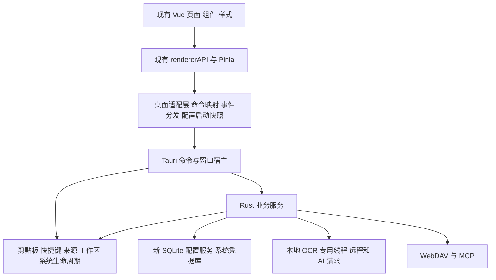

# Super Paste Tauri 重写方案

> 文档状态（2026-11-09）：本文保留重写实施期的设计与决策记录。Tauri 工程现已提升到仓库根目录，旧 Electron 与 native 参考工作目录已移除；下文的 `super_paste/`、父目录、并列工程及“不修改外层工程”均是实施期约束，不再表示当前目录结构。当前使用、构建与发布入口以 [README](../README.md)、[开发规范](../AGENTS.md) 和实际源码为准，无需重新执行初始化命令。原业务基线链接固定到替换前的 Git 提交；native 路径仅记录历史来源，当前纳入的代码与补丁见 `src-tauri/vendor/` 和 [第三方声明](../THIRD-PARTY-NOTICES.md)。

在当前仓库的 `super_paste/` 目录，先使用 Tauri 官方 `create-tauri-app` 初始化独立的 Tauri 2 项目，再开发业务。以当前 Electron 项目作为全部业务能力、前端接口和界面行为的唯一基线，直接复用当前 Vue UI 代码，只做必要适配；`super_paste_rs_native` 仅用于库选型、库调用方式和底层实现经验的参考，不定义重写项目的功能范围、业务规则或验收标准。

本文是实施方案，不表示已经完成重写或通过跨平台验证。业务基线为当前 Electron 项目；native 目录仅作为技术参考。

## 1. 目标与边界

### 1.1 交付目标

- 保留现有页面、组件、布局、样式、主题、图标、文案和操作流程，包括设置窗口、剪贴板面板、详情弹窗、右键菜单、搜索、筛选与键盘操作。
- 保留剪贴板历史、多格式恢复、标签、来源应用、OCR、二维码、复制统计、AI 用量、WebDAV、MCP、托盘、自启和系统恢复后的监听能力。
- 保持现有前端业务 API 的方法签名、响应结构和事件含义，通过适配层连接 Rust 服务。
- 采用独立的数据目录、新数据库与配置设计，提供单独的一次性迁移工具承接 Electron 数据；应用运行时不保留旧格式兼容层。
- 最终运行产物使用 Tauri、系统 WebView 和 Rust 服务，不依赖 Electron、Node 运行时或 Node 原生扩展。

### 1.2 不纳入本次重写

- 不重写 Vue 组件，不迁移到 GPUI，不替换 Pinia、路由、CSS 或现有图标体系。
- 不根据 native 已实现或缺失的功能增加、删减当前业务；不引入其独立详情窗口、AI 多配置档案、凭据同步选项等当前没有的交互。
- 不将配置同步扩展为历史、图片、标签或数据库同步。
- 不调整分类、搜索、清理、统计和快捷键的业务语义；数据库布局、摘要算法、任务调度和配置存储等内部实现可以重新设计，不复刻旧实现缺陷。
- 不要求新旧磁盘格式或 WebDAV 协议互通，不提供新版新增数据反向写回 Electron 的工具。
- 不预设包体、内存或启动速度的收益数字；在最终产物上测量实际结果。

平台范围沿用当前产品能力：Windows、macOS、Linux X11；KDE Plasma 6 Wayland 单独处理。其他 Wayland 桌面根据实际协议能力报告状态，不因为使用 Tauri 就宣称具备完整支持。

### 1.3 独立项目边界

- 新项目根目录为 `super_paste/`，前端、Rust 后台、依赖、锁文件、文档、第三方声明、构建配置和发布脚本均放在该目录中；不得新增或修改外层 Electron 工程文件。
- 当前仓库根目录的 `src/`、`package.json`、Electron 构建与发布入口继续保留，作为业务基线和对照，不进行原地改造或删除。
- `super_paste_rs_native/` 保持参考用途，不作为运行依赖，不向新项目提供业务服务。
- 新项目直接复制当前 Vue 源码和共享契约，再在副本中适配；不通过符号链接、跨目录 alias 或运行时加载依赖旧项目源码。
- 新旧应用使用独立的应用标识、可执行文件、数据目录、自启条目和单实例范围，可并存安装；新应用不自动卸载、替换或接管 Electron 应用。
- 本方案中指向仓库根 `src/` 的链接用于定位原有业务实现；新项目实现路径统一位于 `super_paste/` 内。
- 发布工作流也保留在本子目录的 `.github/workflows/`。GitHub 不自动发现嵌套工作流；将本目录作为独立仓库根目录时可启用，不在外层 Electron 仓库增加发布入口。

### 1.4 已确定的兼容边界

| 对象                  | 目标要求                                                                         |
| --------------------- | -------------------------------------------------------------------------------- |
| Vue UI 与前端业务 API | 直接复用组件和样式，保留方法、DTO、事件含义；仅修改宿主适配和已列明的少量接入点  |
| 当前业务能力          | 全量保留，不以 native 的能力、默认值或限制替代                                   |
| 本地数据              | 新目录、新设计；旧数据由独立工具一次性导入，不共享写入                           |
| WebDAV                | 独立远端目录、版本化新格式；仅同步非敏感设置；双向冲突保留双方并报告             |
| 本机凭据              | 使用系统凭据库，不写入普通配置、WebDAV、迁移报告或诊断包                         |
| MCP                   | 新端口、新密钥，首次默认关闭；客户端需更新连接配置，工具与请求、结果格式保持兼容 |
| 调试导出              | 保留入口，将 V8 heapdump 改为 Rust 诊断导出                                      |
| 回退                  | 保留旧应用和原始数据；不承诺旧应用可读取新版数据                                 |

## 2. 当前业务依据与库实现参考

当前项目的业务契约以以下实现为准：

- [前端 API 和数据结构](https://github.com/Teddy-Zhu/super_paste_app/blob/b012685fbfa1e31a0be6e0d1085fc8cdb17bebf1/src/renderer/src/api/types.ts)、[业务 API 封装](https://github.com/Teddy-Zhu/super_paste_app/blob/b012685fbfa1e31a0be6e0d1085fc8cdb17bebf1/src/renderer/src/api/renderer-api.ts)、[主进程命令](https://github.com/Teddy-Zhu/super_paste_app/blob/b012685fbfa1e31a0be6e0d1085fc8cdb17bebf1/src/main/communication/ipc-manager.ts)。
- [配置默认值](https://github.com/Teddy-Zhu/super_paste_app/blob/b012685fbfa1e31a0be6e0d1085fc8cdb17bebf1/src/shared/preferences.ts)、[配置同步契约](https://github.com/Teddy-Zhu/super_paste_app/blob/b012685fbfa1e31a0be6e0d1085fc8cdb17bebf1/src/shared/store-sync.ts)、[Pinia 同步桥接](https://github.com/Teddy-Zhu/super_paste_app/blob/b012685fbfa1e31a0be6e0d1085fc8cdb17bebf1/src/renderer/src/stores/syncBridge.ts)。
- [剪贴板处理链](https://github.com/Teddy-Zhu/super_paste_app/blob/b012685fbfa1e31a0be6e0d1085fc8cdb17bebf1/src/main/features/clipboard/worker/clipboard-manager.worker.ts)、[内容分类与哈希](https://github.com/Teddy-Zhu/super_paste_app/blob/b012685fbfa1e31a0be6e0d1085fc8cdb17bebf1/src/main/features/clipboard/types/clipboard-types.ts)、[数据库实现](https://github.com/Teddy-Zhu/super_paste_app/blob/b012685fbfa1e31a0be6e0d1085fc8cdb17bebf1/src/main/infrastructure/database/clipboard-database.ts)。
- [浮层窗口控制](https://github.com/Teddy-Zhu/super_paste_app/blob/b012685fbfa1e31a0be6e0d1085fc8cdb17bebf1/src/main/ui/windows/window-managers.ts)、[前后端动画事件](https://github.com/Teddy-Zhu/super_paste_app/blob/b012685fbfa1e31a0be6e0d1085fc8cdb17bebf1/src/shared/overlay-events.ts)。

能力清单从上述当前项目的页面、API、后台调用链及实际行为整理，再逐项在新项目实现。native 是否具备同名功能不影响这份清单；原项目已有能力不能因 native 尚未实现而省略，native 新增能力也不能自动进入本次范围。

native 的作用是帮助选择 Rust 库和理解底层接口，以下均是技术候选及用法参考，不是可直接接入的业务能力：

| 技术环节        | 可参考的库与实现位置                                                                                                                                                       | 新项目使用原则                                                         |
| --------------- | -------------------------------------------------------------------------------------------------------------------------------------------------------------------------- | ---------------------------------------------------------------------- |
| 多格式剪贴板    | `clipboard-rs`、`wl-clipboard-rs`；clipboard-core（`super_paste_rs_native/vendor/clipboard-core/src/lib.rs`）                                                              | 参考底层读写、监听及组合格式处理；采集、去重、恢复和事件按当前项目重写 |
| 快捷键与 Portal | `global-hotkey`、`ashpd`；hotkey.rs（`super_paste_rs_native/src/platform/hotkey.rs`）                                                                                      | 参考库调用和 Portal 会话处理，注册规则和状态按当前契约实现             |
| 来源应用与 KWin | `active-win-pos-rs`、`kdotool`、`dbus`；active_window.rs（`super_paste_rs_native/src/platform/active_window.rs`）、kwin.rs（`super_paste_rs_native/src/platform/kwin.rs`） | 参考平台查询接口，来源冻结、截图追踪及持久 ID 由当前业务决定           |
| 工作区与图标    | 系统 API、图标解析库；work_area.rs（`super_paste_rs_native/src/platform/work_area.rs`）、source_icon.rs（`super_paste_rs_native/src/platform/source_icon.rs`）             | 参考坐标和资源读取方式，窗口位置和图标展示以当前 UI 为准               |
| 本地 OCR        | `oar-ocr`、`oar-ocr-core`、`image`；ocr（`super_paste_rs_native/src/ocr/mod.rs`）                                                                                          | 参考模型推理和图像处理接口，按当前 OCR 输入、输出及任务流程组装        |
| SQLite          | `tokio-rusqlite`；storage.rs（`super_paste_rs_native/src/storage.rs`）                                                                                                     | 参考异步调用和连接管理；重新设计单库结构，保留当前查询及统计语义       |
| HTTP 与 WebDAV  | `reqwest`；sync.rs（`super_paste_rs_native/src/sync.rs`）                                                                                                                  | 参考 HTTP 请求与取消方式；保留同步业务入口，按本方案实现新协议         |
| MCP HTTP 服务   | `rmcp`、`axum`；mcp/mod.rs（`super_paste_rs_native/src/mcp/mod.rs`）                                                                                                       | 参考 SDK 接入及会话机制；工具 schema、鉴权和响应按当前项目实现         |
| 二维码          | `qrcode`、`rqrr`、`image`；preview/qr.rs（`super_paste_rs_native/src/preview/qr.rs`）                                                                                      | 参考库用法；参数、结果和错误行为保持当前业务                           |

不将 native 的 `Services`、配置、数据库、MCP Backend、同步协议或 UI 模块整体搬为新项目底座。确需使用通用底层封装或库补丁时，先逐项核对当前调用要求，再以最小范围纳入新项目维护，不能连带引入其业务默认值、限制或策略。

来源应用与图标现采用 [x-win 5.8.0 官方 Rust API](https://docs.rs/x-win/5.8.0/x_win/)：使用 `get_active_window()` 识别来源，将同一个 `WindowInfo` 传入 `get_window_icon()`，直接复用返回的 PNG data URI。KDE Plasma 6 Wayland 保留 KWin 查询与 GTK 主题图标适配，因为 x-win 的 Wayland 后端面向 GNOME；不将 KWin UUID 转成 X11 窗口 ID。来源冻结、截图来源追踪、持久 ID 和前端数据结构仍沿用当前业务契约。图标失败不永久缓存，同一窗口五秒后可重试，切换到同应用另一窗口可立即重试。

已确认不能直接照搬的差异：

1. native 使用整数历史和标签 ID，当前 UI 和 MCP 使用字符串 ID。
2. native 与当前项目的内容序列化和摘要规则不同；新项目可采用 SHA-256，但规范化内容必须由当前业务格式决定。
3. native 的颜色、URL、代码、电话判断及纯文本提取规则与当前实现不同。
4. native 的历史查询结构不足以直接承接当前多标签、类型、排序方向等查询参数；统计查询结构也不同。
5. native 的配置、数据库和同步格式不是新项目规格；旧数据只由独立迁移工具读取。
6. native 在写入后有自己的回读抑制规则；直接采用会改变当前事件、历史更新和复制统计行为。
7. native 的 Wayland 面板使用 GPUI Layer Shell。它不是能直接搬到 Tauri 的窗口代码。

### 2.1 能力与通信映射基线

下表列出当前已实现并实际使用的主要入口。每组在开发前需对照 `api/types.ts`、`renderer-api.ts`、共享契约和实际 handler，登记参数/返回类型、默认值、错误、事件载荷、接收窗口及副作用；引用现有类型定义，不另抄一份可能漂移的 DTO。Tauri command 使用 Rust 名称，旧通道名只保留在前端映射表中。

| 能力         | 当前命令/入口                                                                                                                                                                                   | Rust 责任与事件                                                                                |
| ------------ | ----------------------------------------------------------------------------------------------------------------------------------------------------------------------------------------------- | ---------------------------------------------------------------------------------------------- |
| 历史与监听   | `clipboard-get-history`、`clipboard-delete-item`、`clipboard-clear-history`、`clipboard-get-status`、`clipboard-start-listening`、`clipboard-stop-listening`、`clipboard-update-config`         | 历史查询、删除/清空、采集状态及配置；`clipboard-history-updated`、当前实时剪贴板与监听状态事件 |
| 恢复         | `clipboard-restore`、`clipboard-restore-as-text`、`clipboard-restore-ocr-text`                                                                                                                  | 原格式、纯文本和 OCR 文本恢复；保留多格式写回及统计语义                                        |
| 标签         | `get-all-tags`、`create-tag`、`update-tag`、`delete-tag`、`get-tag-stats`、`bind-tag-to-record`、`unbind-tag-from-record`                                                                       | 完整增删改、统计和绑定/解绑；`tags-updated`，以及按当前范围触发的历史更新                      |
| OCR 与二维码 | `clipboard-parse-ocr`、`clipboard-parse-qrcode`、`clipboard-generate-qrcode`                                                                                                                    | 历史 OCR、二维码解析和生成；`record-ocr-updated`、`ocr:task-status`                            |
| 模型与 AI    | `ocr:list-models`、`ocr:download-model`、`ocr:cancel-download`、`ocr:delete-model`、`ocr:redownload-model`、`ocr:ai-list-models`、`ocr:ai-test-connection`                                      | 模型状态机和 AI 请求；`ocr:model-status`、`ocr:usage-updated`                                  |
| 统计         | `statistics:get-copy`、`statistics:clear-copy`、`ocr:get-usage`、`ocr:clear-usage`                                                                                                              | 复制统计和 AI 用量；`statistics:copy-updated`、`ocr:usage-updated`                             |
| 配置         | `store:get-snapshot`、`store:patch`；托盘等后台修改                                                                                                                                             | 权威快照、字段版本、提交确认与回滚；`store-value-changed`                                      |
| WebDAV       | `scheduled-sync:test-connection`、`scheduled-sync:manual-sync`、`scheduled-sync:manual-sync-with-config`、`scheduled-sync:get-status`                                                           | 测试、手动与定时任务；`sync-status-updated`、`sync-requires-restart`                           |
| MCP 管理     | `mcp:get-state`、`mcp:save-settings`、`mcp:generate-key`                                                                                                                                        | 独立 HTTP 服务状态、配置和密钥；`mcp:status`                                                   |
| 系统与窗口   | `system-access-status`、`system-access-retry`、`open-overlay-window`、`close-overlay-window`、`open-main-window`、`open-external-url`、`app:window-minimize`、`app:window-close`、`app:restart` | 权限状态/重试、窗口和生命周期；窗口握手按第 6 节                                               |
| 诊断         | `export-heapdump` 的现有调用位置                                                                                                                                                                | 适配为诊断导出，返回语义仍接入现有成功/失败提示                                                |

具体 Rust 映射及事件从调用链核对，不能用名称猜测实现。`get-all-apps`、`get-app-cache-stats` 等只有声明、没有已注册实现和实际页面调用的接口不构成待补业务；注册但未被页面调用的内部初始化接口须按后台生命周期确认，不能反向要求 UI 增加入口。自启由配置变更触发，也不能仅按直接 IPC 调用判断是否遗漏。

配置、历史、标签、OCR、统计和同步通知按当前实际订阅范围分发，不能一律只发给发起窗口；浮层动画握手只发送到浮层。事件表同时记录触发顺序和接收窗口，作为实现及集中验收的同一份清单。

## 3. 目标架构



### 3.1 先用官方工具初始化

开发的第一步使用 [Tauri 官方项目生成器](https://v2.tauri.app/start/create-project/)，不手工拼装 Tauri 工程，也不复制 native 的工程骨架。初始化前确认目标目录没有业务文件，仅移除占位文件，不能让生成器覆盖已有实现。

在仓库根目录执行：

```sh
pnpm create tauri-app
```

交互项选择项目目录 `super_paste`、TypeScript/JavaScript、pnpm、Vue、TypeScript，应用标识使用 `com.v2dawn.superpaste`。使用生成的 Tauri 2 工程，记录生成器实际版本，将项目自身的依赖锁文件纳入工程。初始化结束后才在生成的工程上调整目录、依赖、标识和业务代码，不把生成器仅当作事后校对工具。

接续顺序：

1. 保留官方生成的 `src-tauri/`、`build.rs`、入口、CLI 和 Vite/Tauri 配置关系，建立独立 pnpm 边界。
2. 从当前项目复制 Vue renderer、共享契约和所需静态资源，移除生成器的演示页面、演示命令及样式，避免与原有 UI 混用。
3. Vite 指向复制的 renderer 入口，前端输出统一为新项目 `dist/`，Tauri `frontendDist` 对应该目录。保留原项目的路由、布局、自动导入和图标插件。
4. 新项目 `pnpm dev` 启动 `tauri dev`，`dev:renderer` 启动 Vite，`build` 启动 `tauri build`，`build:renderer` 负责前端构建；分别配置 `beforeDevCommand`、`beforeBuildCommand`，避免脚本递归调用。保留官方生成的 `tauri` CLI 入口。
5. 接入通信、启动快照、双窗口与 Rust 服务，随后开展业务开发。模板生成成功不代表任何原业务已经完成。

实施时已先执行官方生成器：`pnpm create tauri-app super_paste_rs --template vue-ts --manager pnpm --identifier com.v2dawn.sp.rs --tauri-version 2 --yes`，实际原生生成器版本为 `4.8.0`；后续业务开发基于该生成结果展开。

当前工程目录已统一为 `super_paste/`，产品名为 `Super Paste`，应用标识为 `com.v2dawn.superpaste`；上述命令保留实际初始化记录。

### 3.2 项目组织与运行边界

在 `super_paste/` 内采用一个 Tauri 业务 Rust crate，按模块划分责任；旧格式解析放在独立迁移工具中。主应用与工具通过轻量 `data-format` crate 共享新 schema、建表/升级 SQL、内容摘要及新 manifest 定义，避免各自实现目标格式；该 crate 不依赖 Tauri 或旧解析器。前端从现有源码复制并保留内部目录组织，不重新实现组件。新项目单独安装、开发和构建，不替换仓库根 Electron 工程。

```text
super_paste/                 # 新项目根目录，与当前 src/、docs/ 并列
  package.json                 # 仅声明新项目需要的前端和构建依赖
  pnpm-lock.yaml
  pnpm-workspace.yaml          # 独立边界，避免继承父级 Electron workspace
  vite.config.ts               # 参考当前 renderer 构建配置
  tsconfig*.json
  .gitignore
  src/
    renderer/                  # 复制当前 src/renderer，保留 Vue UI 代码
    shared/                    # 复制当前共享契约，只在副本中做必要适配
  resources/                   # 当前产品需要的运行资源
  build/                       # 复用当前产品图标等打包资源
  scripts/                     # 新项目自己的构建与发布脚本
  crates/data-format/          # 主应用与迁移工具共享的新格式，含 schema/摘要定义
  tools/migrate-electron/       # 独立迁移 CLI，另有脚本入口，不被主应用依赖
  src-tauri/
    build.rs                   # 官方生成基础上维护
    tauri.conf.json
    capabilities/              # 按窗口约束桌面能力
    Cargo.toml
    Cargo.lock
    src/
      lib.rs                   # Tauri 初始化和依赖装配
      commands/                # 当前 IPC 业务命令的适配
      core/                    # 按当前项目重写业务编排
      storage/                 # 新 app.db 配置版本 数据路径 凭据引用
      platform/                # 剪贴板 快捷键 来源 窗口 平台事件
      ocr/                     # 推理 模型下载 远程和 AI 协议
      mcp/                     # 当前 MCP 对外契约
      sync/                    # 新版 WebDAV 协议与冲突处理
    vendor/                    # 仅在库兼容确有需要时放置最小封装或补丁
```

正式构建不通过 path dependency、导入或启动进程依赖 `super_paste_rs_native/`，也不直接加载父目录 Electron 工程的依赖和资源。使用的通用封装、补丁和静态资源在新项目内自包含，记录来源并保留许可证；不默认提取 native 的应用模块。

Tauri 负责桌面主事件循环，Rust 服务使用其异步运行环境；SQLite 和本地 OCR 放在专用线程，不阻塞主线程。原生窗口、快捷键等要求主线程的操作通过 Tauri 调度，不复制 GPUI 的轮询泵，也不为每个请求创建新的 Tokio runtime。

## 4. 前端复用与最小适配

### 4.1 保留范围

将当前 `src/renderer/` 直接复制到 `super_paste/src/renderer/`，将所需 `src/shared/` 复制到 `super_paste/src/shared/`。复用现有 `pages`、`components`、`composables`、`layouts`、`assets`、路由和 `renderer-api.ts` 的业务调用；已有富文本净化、RTF 预览、图片 Blob URL、列表引用复用和滚动逻辑继续使用，不根据 native 界面重新编写。

以下修改均在新项目副本中完成，原 Electron 前端保持不变。页面不直接导入 Tauri 插件，所有宿主差异集中在 API 层、启动入口和少数系统交互接入点。

| 适配位置                          | 修改内容                                                                                                                                    |
| --------------------------------- | ------------------------------------------------------------------------------------------------------------------------------------------- |
| `api/ipc.ts`                      | 保留 `invoke/send/on/onSimple/once` 等调用形式，底层连接 Tauri commands/events                                                              |
| `api/types.ts`、共享类型          | 用应用自己的事件类型替代 `IpcRendererEvent`；把仍引用 `@main`、`@preload` 的纯类型移到 `src/shared`，同步调整 `SyncSettings.vue` 的类型导入 |
| `main.ts`、`stores/index.ts`      | 获取启动配置和平台信息后再挂载应用，避免默认配置闪现或回写                                                                                  |
| `stores/syncBridge.ts`            | 保存失败后的权威快照读取改成异步，保留字段合并、版本判断和待发送修改                                                                        |
| `ShortcutSettings.vue`            | 将少数 `window.electron.process.platform` 读取替换成同步可读的平台信息适配接口                                                              |
| `pages/index/index.vue`           | 给现有标题栏增加拖动接入，保留拖动区、按钮区及视觉样式                                                                                      |
| `index.html`、类型配置、Vite 配置 | 调整宿主标题、CSP、类型来源与构建入口                                                                                                       |

`navigator.clipboard` 等零散系统调用统一接入已有桌面 API；页面只替换调用，不改变按钮行为。

### 4.2 通信契约

- 将现有 IPC 命令逐项映射为明确的 Rust command，参数顺序在适配层转换，响应仍按各现有接口返回；不强迫所有响应改成一种新结构。
- 映射表显式列出可用命令、事件与转换函数，拒绝未知通道，不提供任意 `invoke`、shell 或文件读写透传。Rust DTO 显式配置 serde 字段名，并逐项对应现有 TS 类型。
- 保留业务错误的 `success/error/message` 语义；系统调用失败不得返回伪造的成功结果。
- 将已用事件在启动时注册完成，再向组件提供同步的本地订阅和取消函数，避免把 Tauri 的异步监听注册传播到每个组件。
- 适配层维护监听器表，处理注册未完成时的取消、一次性监听及组件卸载，保留多个订阅者互不影响的行为。
- 浮层事件只向对应窗口发送；配置、历史、统计等事件按当前范围广播。后端从调用窗口获取身份，不信任前端自报的窗口 ID。
- 图片经过传输后在 API 边界恢复成 `Uint8Array`，组件继续使用现有数据结构。首次迁移不改变列表的数据加载方式；仅在集中验证发现实际大图传输瓶颈时，在同一适配边界内使用二进制响应。
- Rust 内部命名可以使用 snake_case，前端 DTO 的字段名、可选值和枚举值保持当前形式；不能让 `Vec<u8>`、`null` 或 Rust 内部枚举直接泄漏到现有组件。

### 4.3 配置启动与多窗口同步

新增一次启动握手，先完成事件通道注册，再读取 `settings`、`sync` 的权威快照及平台信息。握手期间缓冲配置事件，按版本应用；初始化结束后再创建 Pinia 并挂载页面。

配置交互重新实现为后端权威状态与前端修改请求：`注册监听并缓冲 → desktop_bootstrap 获取一致快照 → 创建并填充 Pinia → 按字段版本应用后续通知 → 挂载`。同时核对路由守卫等调用点，避免提前实例化 store。握手失败使用明确的启动错误和重试，不挂载可写的默认配置，也不让隐藏浮层自行显示错误页面。

不继续搬运旧 `fieldChangePlugin`、双向 deep-watch 回写或 `pinia-plugin-persistedstate` 的跨进程 storage 桥接。Pinia 只保存界面所需投影和待提交修改，不再独立持久化配置；移除同步 IPC、伪同步缓存协议和另一份前端配置事实来源。保留现有组件和 `v-model` 用法，由 store 的受控 setter/action 提交修改请求，允许只对相关脚本做适配。

运行中使用明确的命令提交 `patch + clientId + mutationId + baseVersions`，Rust 校验、字段级并发判断、持久化和应用副作用后返回权威快照、字段版本及凭据元数据；失败也返回可恢复的权威状态和具体错误。前端集中串行提交或合并尚未发出的同字段修改，保留提交期间新产生的编辑，不让旧响应覆盖新输入。`$whenSynced` 如有现有调用，仅作为等待待提交请求完成的门面，不承担隐式监听回写。

`store-value-changed` 是后端到窗口的单向已提交通知；应用通知不触发新写入，不以事件回声替代命令确认。`mutationId` 用于识别本窗口的提交，字段版本用于忽略过期通知和合并其他窗口的修改；不能用整份配置 revision 替代字段级合并语义。连接或事件订阅恢复后重新读取权威快照，避免主窗口与浮层状态分叉。

启动命令返回 `{ config: { settings: ConfigReadResult, sync: ConfigReadResult }, platform }`，其中 `ConfigReadResult` 包含 `snapshot: { value, version }`、`fieldVersions`、`credentialFields`；配置服务和前端使用同一结构，不再维护另一套扁平快照协议。

凭据字段另有可用性元数据：区分未设置、已配置引用（`configured`）、实际读取成功、读取失败和窗口无权读取，不能把脱敏/未加载字段视为用户清空。启动快照与普通配置提交仅查询数据库元数据，不探测或解锁系统凭据库；`configured` 不保证凭据库此时可用。启动快照不返回已存密钥明文，表单通过状态与占位提示区分已保存和未设置；广播事件直接省略密钥属性，不能用空串代替，事件的凭据状态统一为 `unavailable`。请求使用 `credentialChanges: {路径: set | unset}` 明确表达用户意图，普通字段修改剔除密钥，没有明确意图的密钥写入和浮层凭据写入由后端拒绝。设置窗口读取失败时保留原引用，不将空白投影回写为清除。

AI 模型查询/连接测试、WebDAV 连接测试/手动同步先等待相关表单保存完成，再由 Rust 按指定服务读取本机凭据；不要求前端重新取得已存明文，也不把脱敏空值当成实际密码。仅当对应能力执行时读取其所需凭据，未解锁的 AI 凭据不能阻塞主题、窗口或剪贴板历史。该处理集中在配置客户端与 store 中，继续使用现有表单。

### 4.4 WebView 兼容

Tauri 分别使用 Windows WebView2、macOS WKWebView、Linux WebKitGTK，不能沿用 Electron 自带同一 Chromium 的假设。集中验收覆盖当前 `:has()`、原生 `dialog`、滚动条、输入法、快捷键事件和剪贴板调用；差异通过局部兼容代码处理，保持现有样式与交互，不借此替换组件。

CSP 仅增加 Tauri IPC 和实际使用的资源协议所需配置，区分开发服务器与发行包；保留富文本净化和当前 `data:`、`blob:` 图片使用方式，不把外部剪贴板 HTML 作为可执行页面加载。

### 4.5 必须明示的诊断适配

当前调试页的 `export-heapdump` 导出 Electron 主进程和 Node Worker 的 V8 堆快照。Rust 没有对应的 V8 堆，不能伪造兼容文件。

保留调试页布局与导出入口，将该动作最小调整为“导出诊断信息”，输出服务状态、任务和队列状态、内存信息、WebView 版本及脱敏日志；仅修改相关文案和调用。这是运行时诊断能力的替换，不涉及剪贴板主要业务。若仍需 WebView 专用堆分析，使用对应引擎的开发工具，不将其冒充原 Node 堆快照。

## 5. Rust 后台实施要求

### 5.1 剪贴板、来源与历史

按照当前 `@teddyzhu/clipboard` 的使用契约，以 `clipboard-rs`、`wl-clipboard-rs` 等库实现新项目的 Rust 剪贴板适配。native 的 `clipboard-core` 仅用于参考底层接口和组合格式处理经验，例如 Windows 图片与其他表示的写入顺序；是否采用其中的通用封装由当前格式兼容要求决定，不将其捕获流程或状态作为业务来源。

业务处理顺序以当前 Worker 为准：原始变化检测 → 冻结来源 → 内容转换 → 实时变化通知和复制统计 → 历史去重与保存 → 异步 OCR → 按需要通知 UI。恢复功能仍然是写回系统剪贴板，不新增自动模拟粘贴。

需要保留的具体规则：

- 分类优先级、文件与图片组合处理、RTF/HTML 选择、URL/颜色/电话/代码规则按现有实现移植。
- 新内容摘要采用 SHA-256，按当前内容格式语义定义规范输入，明确格式标识、长度边界、文本编码和文件顺序；图片使用尺寸及完整规范化像素，原始表示仍保留用于恢复。不依赖 JavaScript 序列化或采样哈希。数据库约束保证整个保留历史范围内去重，内存索引仅加速，不复刻旧缓存容量导致的边界行为。
- 对前端和 MCP，历史 ID、标签 ID、应用 ID 始终是不可解析的字符串；新建对象采用独立生成的字符串 ID，不从摘要截断推导。迁移时优先保留旧 ID，必要映射由迁移工具处理；重复内容更新及 `last_used` 的业务含义不变。
- 多标签查询保持当前匹配语义，搜索继续覆盖当前正文/OCR 范围，不扩展搜索范围或增加新的排序规则。
- 来源在异步处理之前冻结，保留当前 `mark-shot` 截图工具使用截图前目标应用的规则；不能只在剪贴板回调时查询当前前台窗口。
- 来源应用按现有应用名称和路径识别，窗口 ID 只作为平台查询信息，不作为持久来源应用 ID。
- 清理继续使用当前保留期限、数量上限和带标签记录保护规则；`-1` 等边界值显式转换，不直接转成 Rust 无符号数量。
- 暂停、重启、系统唤醒后的监听恢复和权限重试继续接入现有状态入口。

采集、写后回读、来源和统计编排以当前 Worker 的业务含义为准，不从 native `Services::capture` 导入。原始变化、自己恢复后的回读、重复内容与新记录分别建模，不能统一抑制后遗漏当前的通知或复制统计。队列满、原生监听退出等错误必须进入状态与日志，不能静默丢弃后继续报告正常监听。

### 5.2 新数据设计、凭据和一次性迁移

#### 新应用存储

以独立应用标识对应的 Tauri `app_local_data_dir()` 为数据根目录，运行时只读取新设计；缓存和日志分别使用新应用的 cache/log 路径，不访问 Electron 目录。配置通过服务投影为现有前端的 `settings`、`sync` 等结构，磁盘结构不受旧 API 形状限制。

| 存储              | 新设计                                                                                                                                  |
| ----------------- | --------------------------------------------------------------------------------------------------------------------------------------- |
| `app.db`          | 一个 SQLite 库，保存历史/来源应用/标签/关联、复制聚合与清空时间、AI 明细/聚合与清空时间、非敏感配置、字段版本、MCP 非敏感设置及同步基线 |
| schema 版本       | 新项目自己的版本序列和顺序迁移；启用外键、WAL、明确的索引及事务边界；不复用 Electron 的数据库版本号                                     |
| 内容与关联        | 历史正文、原始图片和多格式表示保存在库内；摘要和 ID 分离；标签操作、删除与清理以事务保证引用完整                                        |
| `ocr-models/`     | 按新格式记录模型版本、文件大小和摘要；下载到暂存目录，校验完成后原子安装                                                                |
| 系统凭据库        | AI API Key、WebDAV 口令和 MCP 密钥等，SQLite 只保存不透明引用                                                                           |
| `sync-conflicts/` | 双向同步冲突的本机与远端非敏感配置快照，保留定位信息，供现有手动同步流程处理                                                            |
| 迁移标记          | 保存来源指纹、迁移工具/目标 schema 版本、结果计数和完成状态，不保存凭据值                                                               |

SQLite 使用 `tokio-rusqlite` 等库的专用工作线程和有界入口；配置写入、清理、统计刷新通过同一存储服务协调，不能让 OCR 线程或窗口各持一套独立写入状态。查询仍返回现有 DTO，保留日期、筛选、排序、数值及空值语义，不能把新 schema 等同于重新定义业务。

#### 配置和凭据提交

Rust 配置服务是单一写入入口，以串行变更队列维护字段版本。普通保存、托盘操作和同步下载均经过候选值校验、资源准备、事务提交、事件发布；快捷键、自启、OCR、MCP 和定时同步的副作用失败时释放准备资源并恢复一致状态。无法完成补偿时报告真实异常并提供现有重试入口，不能伪报保存成功。旧请求的恢复不能覆盖其他窗口较新的提交。

使用 Rust 系统凭据库封装，优先按 [Keyring 当前应用接入方式](https://docs.rs/keyring/latest/keyring/) 选择 `keyring-core` 与需要的平台 store，对接 Windows Credential Manager、macOS Keychain 和 Linux Secret Service；不把其完整 CLI/所有后端依赖带入主应用。现有输入框及 API 字段保持不变，适配层将凭据字段与非敏感配置拆分；UI 必需的明文只存在于受控内存，不进入浏览器持久化。系统凭据库不可用时明确报告相关凭据操作失败，不自动退回明文文件，不阻断基本剪贴板历史；读取失败与未设置必须区分，不能用空值回写清除原引用。

替换凭据时先写新的独立引用，配置成功指向新引用后再回收旧项；失败只清理由本次创建的临时项。读取给前端的字段和事件按窗口授权，浮层不需要接收凭据值。WebDAV 导出使用显式字段白名单，排除凭据、引用和本机状态，不能依赖字符串替换脱敏。

#### 独立迁移工具

在 `super_paste/tools/migrate-electron/` 实现独立 Rust CLI，并由 `scripts/migrate-electron` 提供脚本入口；工具可单独构建/分发，不要求主应用启动，不成为主应用的依赖。目标 schema、摘要和 manifest 使用 `crates/data-format/` 的同一份定义，旧解析器及其加密依赖只能存在于工具中，不进入应用运行路径。

入口至少提供 `--from <旧数据目录>`、`--to <新数据目录>` 和 `--dry-run`；dry-run 不写目标和系统凭据库。新旧应用的实际数据路径在使用说明与工具输出中明确，目标应对应新应用解析的目录。一次迁移针对新目标，拒绝合并到已使用的数据目录，拒绝覆盖新旧数据；新应用不在首次启动时自动扫描或导入旧数据。多个旧目录由使用者明确指定，不猜测选择。

迁移流程：

1. 要求新旧应用都已退出，检查可识别的运行实例/占用状态。先把源 `.db` 及现存 `-wal` 复制到临时输入目录，再仅对临时副本使用 SQLite 备份 API 获取一致快照；不复制源 `-shm`，由临时副本重建派生索引，避免 SQLite 只读连接修改源共享索引。迁移前后校验源文件指纹；不对源库执行写入或 checkpoint，不遗漏 WAL 内容。
2. 读取下表输入，执行版本、解密、模型摘要和关联检查；不支持的版本明确中止，不拿默认配置掩盖解析失败。
3. 转换到目标目录旁的暂存目录，重算内容摘要，保留可用的字符串 ID。若发现同内容重复记录，确定性合并标签和时间信息、重映射所有关联，并在报告中记录 ID 映射；已有复制和 AI 统计独立迁移，不从历史重建。
4. 校验记录数量变化原因、标签/应用引用、统计时间范围与清空时间、模型文件和目标 schema。迁移可解密的凭据到本机凭据库；不可恢复的凭据不伪造成功，报告需重新填写的字段。
5. 全部必要校验完成后，以完成标记和同文件系统目录重命名提交目标；新应用拒绝将未完成的导入当作正常数据。失败清理本次暂存和新建凭据项，保留源数据。凭据库与文件系统不是同一事务，工具必须记录并补偿本次创建的引用。
6. 同一来源指纹已成功导入时返回已完成，不重复插入；未完成任务可清理暂存后重跑；来源已变化或目标已有新版数据时拒绝增量覆盖。输出脱敏报告，保留 Electron 原始数据作为回退依据。

| 旧输入                    | 迁移要求                                                                                             |
| ------------------------- | ---------------------------------------------------------------------------------------------------- |
| `clipboard-history.db`    | 历史多格式内容、原始图片、来源应用、标签和关联，保留时间信息                                         |
| `clipboard-statistics.db` | 已有小时聚合、维度和清空时间                                                                         |
| `ai-ocr-usage.db`         | 明细、模型及时间聚合、清空时间；不重复累计                                                           |
| `config.json`             | 解密后按字段映射业务设置，凭据转入系统凭据库；不复制旧密文到运行目录                                 |
| `mcp.json`                | 单独读取非敏感设置；不迁移旧密钥，目标初始关闭、使用新默认端口并生成新密钥，报告客户端需更新连接配置 |
| `ocr-models/`             | 验证旧 manifest、模型及字典的大小/摘要，转换为新 manifest；有效模型直接复用文件内容，不强制重下载    |

旧 `conf@14.0.0` 的 AES-256-CBC、PBKDF2-SHA512、`IV + ':' + 密文` 及 `IV.toString()` 的 UTF-8 盐语义，只在迁移工具内按锁定源码实现；旧 MCP 密钥使用 Electron `safeStorage`，不假定离线可解密。旧解密材料从现有实现确定，不在文档、示例或报告中复制。迁移完成后应用只使用新数据设计，不保留旧哈希、表、配置和 manifest 的双格式读取。

### 5.3 本地、远程和 AI OCR

以当前 `esearch-ocr`、`onnxruntime-node`、`canvas` 的实际调用链为规格，在新项目用 Rust 重写。库选型优先参考 native 使用的 `oar-ocr`、`oar-ocr-core`、`image` 及其推理调用方式；模型下载、解压校验、任务取消、输入处理、区域排序、CTC 解码和输出组装均按当前业务独立实现，不将 native OCR 服务直接作为目标实现。

若选定的 OAR 版本仍假定固定输入名，参考 OAR 本地补丁（`super_paste_rs_native/vendor/oar-ocr-core/PATCHES.md`） 按模型元数据选择输入名，只纳入解决当前模型兼容问题所需的修正。字典、输入高度和空格处理以当前项目为准；不能因 native 采用某种预处理就替换现有 OCR 行为。

本地推理固定使用随包分发的 ONNX Runtime CPU `1.28.0`，通过明确的应用资源路径动态加载，不依赖 native 工程、系统安装或运行时隐式下载。Windows x64、Linux x64、macOS arm64 使用锁定摘要的官方 CPU 资源；macOS x64 从同一固定版本源码构建，附带许可证与来源/摘要清单。macOS 最低版本统一为 `13.3`，与 Tauri 配置、编译部署目标和交付说明一致。运行库缺失或加载失败应使本地 OCR 报告不可用，不阻止界面、历史及其他服务启动。

- 模型目录以当前 `src/shared/ocr-models.ts` 为基线。将前后端共同使用的静态模型清单收敛成一份可被 TS/Rust 读取的数据，原 TS 导出接口保留。
- 应用只读取新 manifest；旧模型由迁移工具验证并转换元信息，有效文件不重新下载。
- 使用现有下载、取消、删除、重新下载入口和状态枚举；删除启用模型时保留当前关闭自动 OCR 的处理。
- 识别入口不自动下载缺失模型；缺失或损坏时保持当前失败提示，下载仍由现有模型管理入口触发。
- 同一图片内容摘要和配置版本下合并识别，将结果分发给仍有效的关联记录，避免相同图片重复推理或重复计费；自动与手动请求明确区分。自动 OCR 仍在新图片历史插入后触发；重复内容更新最近使用时间不隐式增加自动重试，手动识别入口继续有效。
- 队列只保存关联记录 ID、图片摘要、配置版本、请求类型和取消令牌，开始处理时才读取图片，不把大量图片副本塞入等待队列。配置切换使正在执行的旧代任务失效，取消并阻止迟到结果写回，不自动重试已经发出的 AI 请求；尚未开始的手动任务保留记录关联并使用新配置重新排队，有效的自动等待任务可随新配置继续，关闭自动 OCR 则取消自动任务。记录删除、模型维护和退出同样取消对应失效任务。
- 本地推理在专用工作线程串行执行，网络任务与其隔离并采用有界入口；参考当前限制选择初始预算，不直接照抄 native 的线程数或图像预算。队列拒绝、取消和服务异常必须反映到现有任务状态。
- 远程 HTTP 保留 JSON/form、图片字段名、额外参数、结果路径和文本规范化方式。
- AI 保留 OpenAI Chat Completions、Responses、Claude Messages、现有 Base URL 规范化、提示词、图片准备和不自动重试策略。
- 保留当前 AI 请求 120 秒超时；其他入口逐项登记现有超时和取消语义，区分排队超时、请求超时、用户取消与退出。超时后释放请求和任务资源，不能让迟到响应恢复已取消状态。
- 保留模型列表读取、测试请求、实际返回用量、缓存 Token、缺失用量及失败记录的统计规则；测试连通性仍计入用量。

本地 OCR 换引擎可能改变文字、换行、空格、段落和置信度。集中验收比较这些结果，发现影响现有业务的差异就调整前后处理，不以“使用同一模型”代替结果兼容性判断。

历史 OCR 与 MCP OCR 共用模型、图像处理和网络客户端，但不混用业务结果：

| 入口              | 输入与返回                                                               | 调度和持久化                                                                                                |
| ----------------- | ------------------------------------------------------------------------ | ----------------------------------------------------------------------------------------------------------- |
| 历史自动/手动 OCR | 历史记录；任务状态事件及记录 OCR 更新                                    | 异步执行，成功后按记录/配置代次写回历史，通知订阅窗口                                                       |
| MCP `ocr_image`   | 当前剪贴板、历史图片或 base64；请求内返回现有 `{text, confidence, mode}` | 保留当前单个 MCP OCR 在途限制；与后台任务共享受控资源，给请求设置期限，不排在无界后台队列后；不回写历史 OCR |

MCP OCR 继续使用当前配置，缺模型时失败，AI 请求仍计入对应 purpose 用量。不能为了复用队列将 MCP 改成返回任务 ID，也不能把所有 OCR 成功结果都写到历史。模型缓存按模型版本管理，模型删除/切换与在用推理协调，不释放仍被使用的会话。

二维码生成/识别采用 Rust `qrcode`、`rqrr`、`image`，参考 native 中的库调用方式，保留当前默认尺寸、边距、纠错级别、数据 URL 和解析失败语义。

### 5.4 统计

保留当前复制统计的时间范围、小时/天/月粒度、类型和来源筛选、数据量定义与清空行为，明确时间单位、时区和区间边界。数据量包括内容和文件路径，不改为文件本体大小。

统计基于实际处理的复制事件，不能改成“新增历史记录数”，也不能从旧历史回填。删除历史或清理记录不减少已有统计。保留延迟批量落库、读取时纳入待写数据及退出刷新行为。

AI 用量继续使用当前 provider、Base URL、model 和 purpose 语义，按当前聚合 SQL 和返回结构重写，保留现有统计查询维度。

### 5.5 WebDAV

保留当前服务器配置页面、毫秒时间单位、上传/下载/双向方向、手动与定时入口、连接测试、状态通知和下载后重启提示。使用 `reqwest` 重写，native 仅提供库调用参考。远端协议重新设计，不读取或覆盖 Electron 的 `config.json`、`version.txt`，不照搬 native 协议。

#### 目录与文档

使用配置的服务器根路径下独立的 `super_paste/v1/config.json`。单个文档同时包含 `formatVersion`、配置 schema 版本、随机 revision、父 revision、毫秒更新时间、规范化 payload 的 SHA-256 和非敏感 payload；不再用两个文件表达同一次提交。时间只用于显示，不作为覆盖依据。

同步字段从当前配置逐项映射成显式白名单。保留可跨设备复用的业务偏好和同步计划；排除 AI Key、WebDAV 口令、MCP 密钥及凭据引用，也排除本机数据/模型路径、权限/下载状态、单实例身份和 MCP 本机连接信息。远程 OCR URL 与自由额外参数可能嵌入令牌，作为本机设置保留。WebDAV 当前连接目标作为本机配置保留，下载不能改变正在使用的服务器身份。新设备通过现有设置页重新填写凭据及本机服务连接参数，不增加凭据同步开关或页面。

#### 双向判断与提交

本机保存上次成功同步的 revision、payload 摘要与远端 ETag，按白名单内容判断本机是否变化；单个同步服务串行协调定时、手动与退出请求。任务取得配置版本和连接目标快照后在数据库事务/配置锁之外执行网络 I/O，提交前检查本机版本；期间的新修改不得被旧响应覆盖，也不能持锁等待配置副作用导致互相等待。

| 相对上次成功基线                  | 处理                                                                                                |
| --------------------------------- | --------------------------------------------------------------------------------------------------- |
| 双方未变化，或双方 payload 已相同 | 不覆盖，仅确认/更新基线                                                                             |
| 仅本机变化                        | 校验当前远端版本后上传                                                                              |
| 仅远端变化                        | 校验新文档，经配置服务整体应用并更新基线，保留现有重启提示                                          |
| 双方变化且内容不同                | 保留当前本机配置及远端原件，在 `sync-conflicts/` 保存双方快照，使用现有状态报告冲突，本次不自动覆盖 |
| 首次连接既有远端且没有共同基线    | 内容相同则建立基线；内容不同按冲突处理，不猜测哪端较新                                              |

用户可通过现有方向选择及手动同步明确上传或下载来解决冲突，不新增合并界面。解决后建立新基线；相同未解决冲突不反复创建副本或刷屏。计划任务可以继续检查，但不能自动清除冲突并覆盖任一端。

远端写入使用强 ETag 的 `If-Match`，首次创建用 `If-None-Match: *`；条件失败视为并发变化，重新读取并保留冲突，不能无条件重试覆盖。连接测试使用本次创建的隔离临时对象辨识条件写能力并清理，不改写正式远端配置。不支持必要条件语义的服务器明确报告双向自动写入受限，不能把普通 GET/PUT 成功宣称为并发安全；现有明确方向的手动上传/下载仍可使用。

下载先校验版本、字段、摘要和大小，再通过同一配置服务事务提交；保留本机凭据及排除字段，不直接覆盖底层文件。失败不部分应用，取消不伪报成功；请求结果不确定时读取远端 revision 核实提交状态，后续重试不得重复制造新版本。旧配置由一次性本地迁移工具处理，不给同步服务加入旧协议兼容分支。

### 5.6 MCP

使用 `rmcp + axum` 等库重写当前 MCP 服务，native 仅用于理解 SDK 和 HTTP 会话的接入方式。工具实现与业务 Backend 根据当前项目重写，连接新项目同一份剪贴板、历史与 OCR 服务。

保留 `127.0.0.1`、`/mcp`、可选 Bearer 验证，以及当前八个工具：`get_clipboard`、`wait_for_clipboard_change`、`subscribe_clipboard_changes`、`unsubscribe_clipboard_changes`、`search_clipboard_history`、`get_clipboard_history_item`、`set_clipboard_text`、`ocr_image`。新应用默认端口为 `19528`，独立于 Electron 默认的 `19527`，首次默认关闭并生成新密钥。端口被占用明确报告，不静默改端口；客户端需从现有页面复制新版连接配置。

工具的输入 schema、默认值、响应内容、错误、图片限制、资源 URI、订阅元信息和 cursor 失效规则以当前 `src/shared/mcp.ts`、`src/main/mcp/tools.ts` 为准。Rust 工具 DTO 不得将记录 ID 改为整数解析、增加新的查询参数或替换当前响应结构。

保留 Host/Origin 校验、会话取消、空闲回收和 SSE 退出清理。当前边界为最多 32 个并发 HTTP 请求、16 个会话、15 MiB POST 请求体和 5 分钟会话空闲回收；OCR 入口保留 10 MiB 图片及 4000 万像素限制。等待请求/订阅数量、cursor 生命周期、错误码与超时再按当前共享常量及 handler 逐项映射，不让 SDK 默认值无意替代当前契约。

剪贴板事件 broker 统一维护实时状态、序号、等待者和订阅者；与历史去重/保存解耦，重复内容或未新增历史也不能丢失当前约定的实时事件。MCP 不依赖设置窗口存在；客户端断开、监听关闭、密钥/端口更改、服务重启及退出时清理请求与 SSE，服务状态仍通过现有页面呈现。

## 6. 窗口与系统集成

### 6.1 保留现有双窗口与动画协议

Tauri 只创建现有设置主窗口和浮层，继续加载同一个 Vue 应用及现有 hash 路由，详情继续使用当前弹窗。

主窗口保留尺寸约束、主题、标题栏控制和关闭行为；浮层保留透明、置顶、隐藏任务栏、工作区贴边、键盘焦点及失焦关闭。窗口尺寸和面板动画仍由当前配置与样式决定，不采用 native GPUI 的布局值。

保留现有 `transitionId`、准备打开、开始动画、动画结束、准备关闭和隐藏确认协议，防止快速切换、旧事件及焦点竞争影响新状态。

当前 Electron 使用 `beginFrameSubscription/capturePage` 检查透明帧。Tauri 侧需要针对所选 WebView 实现隐藏绘制、透明背景和首帧协调；不能把 `nextTick` 或双 `requestAnimationFrame` 当成 GPU 已提交的保证，也不能沿用调用不到的 Electron API。若必须使用平台原生 WebView 回调，将其封装在窗口适配模块，Vue 动画主体保持不变。

窗口适配模块负责 native frame barrier：以当前 `transitionId` 关联准备、原生绘制确认与显示/隐藏，只接受当前代次的确认；关闭或新一次打开使旧确认失效。平台实现采用可用的原生帧/快照接口，并明确其能保证的阶段，不把 DOM 动画完成等同于原生呈现。超时中止本次切换、恢复可重试状态并报告，不能直接宣称透明帧已就绪。

### 6.2 Wayland 专项接入

依据当前项目的 Wayland 能力边界实现：剪贴板走 data-control，快捷键走 Portal，KWin 提供来源与工作区，浮层继续满足当前贴边、焦点和显示行为。native 仅用于参考相关库及平台接口的使用方式。

Tauri 官方全局快捷键插件所依赖的 `global-hotkey` 目前声明 Linux 仅支持 X11；Wayland 必须保留额外 Portal 实现。可参考 native `hotkey.rs` 中的 `ashpd` 调用，在新项目独立实现 Tauri 主线程派发，并将 Portal 的请求、授权失败和激活状态映射到当前 `SystemAccessStatus`。依赖的异步后端与主事件循环统一选择，不照抄 native 为 GPUI 选择的全部 feature。

浮层目标方案为 Tauri GTK 窗口接入 GTK Layer Shell，锚点、输出、工作区边距及键盘行为按当前 Electron 浮层语义重新计算。native 可提供 Layer Shell 接口使用经验，但不决定布局和交互。Tauri 提供 `gtk_window()`，但 GTK Layer Shell 要求在窗口 realize 前初始化；“创建时隐藏”不能单独证明满足这个条件。

实施时先核对锁定版本的 Tauri/Tao 窗口创建源码，确定主线程初始化 hook。若公开入口时机不满足要求，将最小创建期扩展限定在 Linux 窗口模块及必要的上游补丁中，不引入 GPUI。此项是平台接入的关键阻塞点，未解决前不能宣称 KDE Wayland 已等价支持；不得用强制 XWayland、普通窗口居中或取消贴边来静默替代。

接入顺序固定为 `取得尚未 realize 的 GTK 窗口 → Layer Shell 初始化并设置输出/锚点/键盘模式 → 创建或装配 WebView → 显示`。若锁定版本允许在隐藏窗口创建后操作，必须核对实际 realize 时机；否则在创建路径加最小 hook，不能在窗口已经 realize 后补调初始化。补丁限定版本、记录来源和变更，后续升级必须重新核对这一时序。

Windows、macOS、X11 使用 Tauri 窗口及必要的原生工作区查询；多屏负坐标、混合缩放、任务栏/面板避让和显示器变化均需正确换算，不能仅根据主显示器定位。

### 6.3 其他系统能力

- 托盘、菜单、主题和主窗口控制由 Tauri 统一管理，继续复用产品图标与当前菜单行为，避免重复创建托盘和菜单状态。
- 新应用自启只保留一个实现，使用自己的注册名、桌面文件/LaunchAgent 和启动路径，保留后台启动语义；不删除、改写或接管旧应用自启。两版是否同时开机启动由用户分别设置。
- 单实例范围仅限新应用身份；第二次启动保留打开设置和 `--toggle-overlay` 行为，不与 Electron 互斥或向其转发命令。
- 退出/重启按停止新输入和 MCP 接入、取消并回收任务、刷新配置及待写统计、关闭数据库、退出的顺序协调；主窗口关闭与整个应用退出区分，不能用立即结束进程跳过落库。
- AppImage 的重启和自启优先保留 `$APPIMAGE` 指向的实际文件，不能使用临时解包目录中的 `current_exe`；其他安装方式使用稳定的安装入口。
- 按当前挂起/唤醒处理链重写平台事件接入；不能只处理应用启动而遗漏恢复监听。
- 系统能力继续通过现有状态和重试 API 展示；来源不可用不应阻断剪贴板基本历史功能。
- 保留现有外部链接的 HTTP/HTTPS 校验；不为适配开放通用 shell、任意文件访问或远程网页的原生权限。

### 6.4 窗口权限和诊断边界

窗口标签固定为设置窗口 `main` 和浮层 `overlay`。Tauri capabilities 显式指定这两个窗口与必要插件能力，移除模板中不再使用的授权，不允许远程页面获得原生权限。

仅配置 capabilities 不足以限制自定义命令：Tauri 默认允许应用窗口调用已注册的自定义命令，见 [官方说明](https://v2.tauri.app/security/capabilities/)。本项目在 Rust command 边界统一根据 Tauri 注入的调用窗口检查集中白名单；未知命令/窗口默认拒绝，不能信任请求中自报的 label。若同时使用 `AppManifest::commands` 生成权限，其声明与集中清单一致，不能存在绕过边界的平行入口。

| 调用范围            | 权限                                                                                  |
| ------------------- | ------------------------------------------------------------------------------------- |
| `main` 与 `overlay` | 按实际调用开放配置非敏感字段、历史/标签/恢复、必要 OCR/二维码、平台状态和受限外部链接 |
| 仅 `main`           | 凭据读取/修改、WebDAV 和 MCP 管理、模型维护、统计管理、诊断导出等设置页操作           |
| 仅 `overlay`        | 浮层准备/动画/隐藏握手；原生确认事件由宿主发出，不接受前端伪造                        |
| Rust 托盘/后台/MCP  | 从自身受控入口调用业务服务，遵守各自业务校验；不通过伪造窗口身份调用 command          |

诊断导出包含版本、平台/WebView、服务状态、队列/内存摘要和脱敏日志，不包含剪贴板正文/图片、凭据、认证头或完整配置。文件位置通过受控保存入口选择，错误通过现有页面提示；无需开放通用文件系统权限。

## 7. 独立构建与使用切换

在 `super_paste/vite.config.ts` 中参考当前 `electron.vite.config.ts` 的 renderer 配置，保留 Vue Router 自动路由、布局、自动导入、图标与组件插件及路径别名。新项目内清理 Electron 类型来源时，将所需共享类型放入新项目自己的 `src/shared/`，移除副本对 `@main`、`@preload` 和父目录的依赖；不移动或删除原项目文件。

`super_paste/` 使用独立的 `package.json`、pnpm 边界和锁文件，只安装 Vue 前端、Vite 和 Tauri 构建所需依赖，不继承父级 Electron `postinstall`、原生模块重建或 workspace 包。开发和打包入口在新目录执行，例如 `cd super_paste` 后运行该项目的 `pnpm dev`、`pnpm build` 及平台打包命令；根目录现有同名命令继续服务 Electron 工程。

以官方初始化工程为基础维护 Tauri 配置、权限、图标与 Rust 锁文件。独立身份统一如下，Vue 业务页面仍复用原有内容，仅调整宿主标题、关于信息和必要的安装身份展示：

| 身份                  | 值/规则                                                                 |
| --------------------- | ----------------------------------------------------------------------- |
| 安装产品名称          | `Super Paste`                                                           |
| 应用标识/凭据命名空间 | `com.v2dawn.superpaste`                                                 |
| 可执行文件            | `super_paste`，Windows 带 `.exe`                                        |
| Linux 包/自启标识     | `super-paste` / `super-paste-bin`，desktop 与自启文件使用新产品名称     |
| 运行数据              | 新标识对应的 `app_local_data_dir()`，不写旧目录                         |
| 版本及 release tag    | 三份应用清单校验一致；使用 `v<version>`，接替旧工程后统一采用新发布入口 |

库依赖根据当前业务需要选择，再参考 native 的用法和兼容经验锁定版本，不整体复制其 `Cargo.toml`、工具链、GPUI 补丁或静态 ORT 构建配置。

新项目发布继续覆盖现有 Windows NSIS、macOS DMG、Linux deb/pacman/AppImage 以及 AUR、便携包入口。Tauri bundler 支持的格式直接使用其产物；Pacman/AUR 等在 `super_paste/scripts/` 中实现必要步骤，不能因默认 bundler 没有对应格式而遗漏。

资源检查在新项目中重新实现当前 `afterPack.js` 承担的必要职责。重新确认 WebView2、WebKitGTK、GTK Layer Shell、托盘库、ORT 链接和 Linux 系统库兼容基线，保留需要分发的模型资源信息及第三方声明。签名与公证由发布环境注入凭据，macOS entitlement、公证与 Windows 签名按 Tauri 新产物制定，不能直接把 Electron 配置当作已适用的证明。

新工作流维护在 `super_paste/.github/workflows/release.yml`，当前嵌套目录不会被 GitHub 自动加载，不修改外层 Electron 发布入口。后续子项目接替仓库根时采用这份工作流，统一 `v<version>` 标签、产品名称、架构和产物路径。构建、便携包、AUR 和发布脚本共用项目元数据，不再分别传入版本，也不硬编码 Electron 的产物名称。Windows x64、Linux x64、macOS Intel/Apple Silicon 分别交付；迁移工具单独作为辅助产物，本轮不触发发布。

本地构建入口统一为 `pnpm build`，额外参数透传 Tauri；`pnpm build:pacman` 自动准备 ORT、生成 DEB，再用本地产物生成 Pacman 包及 AUR 元数据，输出到 `target/packages/`。`pnpm aur:prepare` 可直接复用已有 DEB。版本读取并校验三份应用清单，仓库默认读取环境或 Git origin，无需手动复制 DEB、填写版本和产物路径。当前实验版 Tauri 的旧身份与数据不保留兼容层，使用 `com.v2dawn.superpaste` 新命名空间；原 Electron 一次性迁移工具继续保留。

原 Electron 工程始终保留为业务对照和回退实现。新项目完成集成与验收后，用户选择使用新产物；不通过删除根目录 `src/main`、`src/preload` 或改写根 `package.json` 完成切换。新项目自身最终不包含 Electron/Node 运行依赖。

新旧应用可并存运行，但各自只写自己的数据和远端目录；同时启用全局监听/快捷键时也各自负责，不能自动关闭或控制另一版。迁移时两版必须退出。回退是重新使用仍保留的 Electron 应用及其原始数据，不复制新版数据库回旧目录；新版新增数据继续保留在新版目录，不声称回退后旧版能看到这些内容。卸载任一版不得删除另一版数据或凭据。

## 8. 实施顺序与交付物

以下阶段是实现和集成顺序，不是每阶段启动一轮测试。验证统一在完整业务闭环后进行；只有出现无法通过源码确定、且结果直接决定实现的具体平台阻塞时，才由主执行者限定最小诊断范围。

| 阶段                  | 可验收交付物                                                                                         | 依赖与边界                                                                      |
| --------------------- | ---------------------------------------------------------------------------------------------------- | ------------------------------------------------------------------------------- |
| P0 官方初始化         | 按 3.1 节用 `create-tauri-app` 生成 `super_paste/`，建立 Vue/TS/pnpm/Tauri 2 官方基础及独立身份      | 第一项开发操作；不手工搭工程，不覆盖已有代码，不在模板上重写 UI                 |
| P1 契约与基础设计     | 完整命令/事件/DTO/窗口权限清单；新 schema、配置/凭据投影、迁移映射；锁定库与平台创建期/首帧接入路径  | 从当前业务得出规格；将平台阻塞收敛到具体 API 或最小补丁，不用“后续适配”代替路径 |
| P2 宿主与 UI 复用     | 新存储/配置服务基础、双窗口、平台窗口适配、现有 Vue 副本、通信、启动快照、多窗口同步和权限检查       | 先具备真实启动快照再挂载；沿用组件和动画，未接入能力不能返回假数据或伪成功      |
| P3 剪贴板业务闭环     | 采集与写回、来源及截图追踪、工作区/Portal、历史查询与去重、标签全操作、清理、复制统计                | 基于新单库实现旧业务语义；不引入 native 的业务服务或旧格式运行兼容层            |
| P4 完整服务接入       | 历史/MCP 两类 OCR、模型维护、AI/远程协议、二维码、AI 用量、WebDAV 新协议、MCP 八工具及完整配置副作用 | 当前页面/API/事件全部接入，取消、超时、冲突与失败恢复均有实际实现               |
| P5 迁移与系统交付     | 独立迁移工具/脚本、托盘、自启、单实例、休眠恢复、退出/重启、诊断导出、所有新发行入口和资源清单       | 迁移不修改源数据；新旧身份不互相接管；只准备发行，不发布                        |
| P6 集成收尾           | 按契约清单检查无漏项，清理新项目中失效的 Electron/父目录引用，完成使用/迁移/并存说明和整体代码审阅   | 迁移工具内可保留必要旧解析器；不删除原工程或修改 native 参考目录                |
| P7 集中验收与批量修复 | 统一检查独立构建、业务、迁移、新同步协议和 MCP 兼容；用户验收 UI；汇总修复后必要复验                 | 代码稳定、无并行写入；不搭建 UI 自动化，不重复有效检查，不提交/推送/发布        |

阶段之间持续集成，以能力实际可用为准；模板成功、页面可见、接口占位或某一平台能启动均不能视为完成重写。迁移工具依赖已经确定的新 schema，不反过来迫使主应用保留旧表。

以下是需要在 P1 明确、P2/P4 落实的具体接入点，不是已经验证通过的结论：

| 接入点                 | 收敛方式                                                                                    | 未解决时的判定                                       |
| ---------------------- | ------------------------------------------------------------------------------------------- | ---------------------------------------------------- |
| GTK Layer Shell 创建期 | 核对锁定 Tauri/Tao/Wry 的 GTK realize 顺序，选公开创建入口或维护最小前置 hook               | KDE Wayland 交付未完成，不静默改为 XWayland/普通窗口 |
| 透明首帧               | 给 WebView2、WKWebView、WebKitGTK 分别选择原生绘制确认/快照路径，实现带代次与超时的 barrier | 不能以 DOM 就绪宣称窗口体验等价                      |
| OCR 模型输入和结果     | 核对模型元数据、输入名、字典、预处理、解码及当前结果组装，限定必要 OAR 补丁                 | 不以库可加载代替当前模型和输出已适配                 |
| 系统凭据库             | 按平台选择实际可用的持久凭据后端，定义不可用与读取失败状态                                  | 不落明文，不让空值覆盖已有引用，不宣称依赖环境已满足 |
| WebDAV 并发控制        | 明确条件请求与服务端能力识别，保留失败/冲突状态和手动方向处理                               | 不宣称所有普通 WebDAV PUT 都具备安全双向同步能力     |

优先通过源码和接口文档决定这些路径。只有确实存在无法据此确定、且会阻止后续实现的具体问题，才进行最小定点诊断；这不授权提前启动业务回归、UI 自动化或多平台全量构建。

## 9. 集中验证与完成标准

### 9.1 验证时机和成本

本次只编写方案，不运行应用测试或构建。未来实施遵循：完整实现 → 集成和代码审阅 → 集中验证 → 批量修复 → 必要复验。

稳定后集中运行前端 lint、类型检查和必要的 Rust 编译检查；格式检查限改动文件，不使用全仓格式化改写无关代码。目标平台编译与安装包检查合并到该平台的最终验收，不提前反复全量构建。

业务优先复用现有入口。仅为无法通过已有入口覆盖的具体缺口补充必要的最小非 UI 验证，例如迁移工具、命令 DTO、同步冲突与 MCP 协议；不按文件数量铺测试，不建立额外测试体系。不开设 UI 自动化测试，界面由用户手工验收；本方案不授权执行真实 AI 计费请求或写入用户生产 WebDAV 数据。

### 9.2 验收清单

| 范围         | 完成标准                                                                                                                             |
| ------------ | ------------------------------------------------------------------------------------------------------------------------------------ |
| 工程独立     | 先由官方工具初始化；`super_paste/` 可单独安装、开发与构建；不依赖父级源码、依赖或 native 进程，原 Electron 入口仍保持原有用途        |
| 业务覆盖     | 按当前页面、API、后台与生命周期清单逐项验收，不能以 native 已有或缺少某项功能调整范围                                                |
| UI 复用      | 现有设置页、面板、卡片、详情、右键、主题、筛选、快捷键和滚动行为保留；修改集中在适配层及列明的少数接入点                             |
| 通信与配置   | 启动无默认值回写；事件注册无首轮丢失；双窗口和托盘修改收敛；保存失败恢复不覆盖较新修改                                               |
| 剪贴板       | 五类格式及组合格式可监听、存储和恢复；文件 URI、图片原尺寸、重复内容、纯文本/OCR 文本恢复符合当前语义                                |
| 历史与标签   | 字符串 ID、分类、搜索、多标签匹配、排序、保存期限和标签保护保持一致；标签增删改、统计、绑定/解绑完整；去重不受内存缓存容量影响       |
| 来源         | 常规应用及截图目标来源正确；来源暂不可用时明确报告，基础历史功能继续可用                                                             |
| 数据与迁移   | 新应用只读写新格式；迁移覆盖三库、配置、MCP 和模型；源数据不变；关联/摘要/数量校验、失败重跑和已完成识别有效；无旧解析器运行依赖     |
| 凭据         | 系统凭据库持久保存；配置/远端/报告/诊断无密钥；新设备需重新填写；凭据库失败明确可见且不清除旧引用                                    |
| OCR 与二维码 | 当前模型清单及迁移后模型可用；下载维护和取消完整；文字/换行/空格/置信度差异完成处理；AI/远程协议和用量完整；MCP 同步 OCR 不回写历史  |
| 统计         | 迁移结果与旧统计相符；筛选、时间分桶、空用量、失败请求、清空、待写聚合及退出刷新一致，迁移不重复累计                                 |
| WebDAV       | 在专用验收目录验证新命名空间/格式；非敏感字段范围正确；上传/下载/双向、定时/手动、冲突、条件写、取消和重启提示完整；不触碰旧远端文件 |
| MCP          | 更新端口/密钥后现有客户端可用；八工具参数/结果、字符串 ID、SSE、cursor、鉴权、资源限制和关闭清理保持兼容；默认关闭且不争用旧默认端口 |
| 窗口         | 四向、鼠标所在屏、混合 DPI、快速切换、失焦、透明首帧和主题行为满足原界面要求                                                         |
| Wayland      | KDE Plasma 6 的 Portal、data-control、Layer Shell 和 KWin 路径均实际验收；其他桌面准确报告能力边界                                   |
| 生命周期     | 托盘常驻、关闭行为、自启、第二次启动、命令行切换、休眠恢复、退出和重启均无重复监听或未落库数据                                       |
| 权限与诊断   | 自定义命令实际检查调用窗口；插件授权受限；诊断导出真实且脱敏；无通用 shell/文件访问透传                                              |
| 发行与并存   | 现有发行入口均有新身份产物；干净环境可安装启动；资源齐全；版本/工作流/AUR 独立；自启、升级和卸载不接管另一版                         |
| 回退         | 旧应用及原始数据保留；新版数据独立保留；不要求旧应用读取新版数据或反向同步                                                           |

Windows x64、macOS Intel/Apple Silicon、Linux X11 与 KDE Plasma 6 Wayland 的结果分别记录，不用一个平台的成功代替其他平台。缺少目标环境时明确留下该平台未验收状态，不能宣称跨平台交付完成。

最终交付应同时满足：独立项目由官方工具初始化并位于 `super_paste/`、直接复用当前 Vue UI、当前业务能力逐项完整实现、新数据设计和独立迁移工具完整、新 WebDAV 与现有 MCP 业务契约实现、新旧应用独立并存、运行不需要 Electron/Node、必要集中验证完成，且原 Electron 工程与 native 参考目录保持原有用途。native 只能支持技术选型和库调用实现，不能作为业务能力的来源或验收依据。

## 10. 外部技术依据

- [Tauri 2 官方初始化工具和模板选项](https://v2.tauri.app/start/create-project/)
- [Tauri 开发环境前置要求](https://v2.tauri.app/start/prerequisites/)
- [Tauri 2 调用 Rust 与序列化](https://v2.tauri.app/develop/calling-rust/)
- [Tauri 2 前端事件与通道](https://v2.tauri.app/develop/calling-frontend/)
- [Tauri 2 窗口与拖动区域](https://v2.tauri.app/learn/window-customization/)
- [Tauri WebView 版本与平台引擎](https://v2.tauri.app/reference/webview-versions/)
- [Tauri capabilities 与自定义命令权限](https://v2.tauri.app/security/capabilities/)
- [Keyring 当前应用与平台凭据后端接入方式](https://docs.rs/keyring/latest/keyring/)
- [Tauri WebviewWindow 原生 GTK 入口](https://docs.rs/tauri/latest/tauri/webview/struct.WebviewWindow.html#method.gtk_window)
- [GTK Layer Shell 初始化约束](https://github.com/wmww/gtk-layer-shell/blob/master/include/gtk-layer-shell.h)
- [官方快捷键插件依赖](https://github.com/tauri-apps/plugins-workspace/blob/v2/plugins/global-shortcut/Cargo.toml) 与 [global-hotkey 平台范围](https://github.com/tauri-apps/global-hotkey)

Tauri、GTK 和系统 WebView 的具体行为应按实施时锁定的版本核对；其中 GTK Layer Shell 创建时序与透明首帧接入属于明确需要落实的实现问题。
